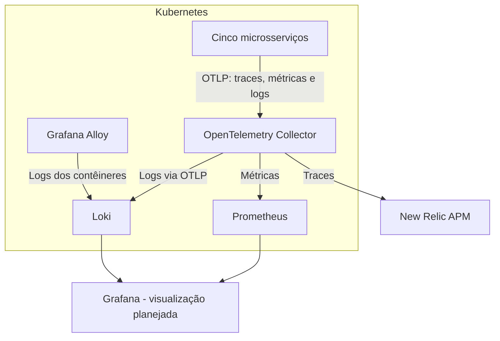

# Toggle Master Microservices - Observabilidade


## **Identificação do Projeto**

- **Projeto:** Toggle Master Microservices
- **Fase:** 04 - Observabilidade
- **Integrantes:** Grupo 68
  - Arthur de Castilho Nascimento - RM371601 - [castartx@gmail.com](mailto:castartx@gmail.com)
  - Gerusa Fernandes Lobo Nogueira - RM367568 - [gerusalobo@gmail.com](mailto:gerusalobo@gmail.com)
  - José Henrique Cavalcanti de Melo Filho -  RM 372074 - [meloricke.bra@gmail.com](mailto:meloricke.bra@gmail.com)
  - Pedro Vinicius Araujo Negreiros - RM372553 - [pedro28vinicius@hotmail.com](mailto:pedro28vinicius@hotmail.com)


## Objetivo do Projeto

A arquitetura é dividida nos em 5 microsserviços:

auth-service (Go): Gerencia chaves de API e autenticação. (Banco de Dados: PostgreSQL)

flag-service (Python): CRUD das definições das feature flags. (Banco de Dados: PostgreSQL)

targeting-service (Python): Gerencia regras complexas de segmentação. (Banco de Dados: PostgreSQL)

evaluation-service (Go): O "caminho quente" (hot path) de alta performance que retorna a decisão final (true/false). (Cache: Redis)

analytics-service (Python): Consome eventos de uma fila e salva dados de análise. (Fila: AWS SQS, Banco de Dados: AWS DynamoDB)

A missão desse projeto é implementar toda a parte de observabilidade nos microserviços de forma a monitorar e gerar alertas das aplicações.


## Visão Geral

A arquitetura de observabilidade do ToggleMaster foi implementada para centralizar a coleta, o processamento, o armazenamento e a visualização de métricas, logs e traces dos microsserviços executados no Kubernetes.

A solução combina ferramentas open source, integradas ao Kubernetes por meio de Helm charts e GitOps com Argo CD, com o New Relic para Application Performance Monitoring (APM) e Distributed Tracing.

Os principais objetivos são:

- Monitorar a saúde dos recursos do cluster Kubernetes.
- Centralizar os logs dos contêineres.
- Coletar e consultar métricas de infraestrutura e aplicações.
- Rastrear requisições distribuídas entre os microsserviços.
- Identificar falhas e facilitar a análise de problemas.
- Preparar a infraestrutura para dashboards, alertas e mecanismos de recuperação automática.

## Ferramentas utilizadas

| Ferramenta              | Responsabilidade                                             |
| ----------------------- | ------------------------------------------------------------ |
| Prometheus              | Coleta, armazenamento e consulta de métricas.                |
| Loki                    | Armazenamento e consulta centralizada dos logs.              |
| Grafana Alloy           | Descoberta dos pods Kubernetes e coleta dos logs dos contêineres. |
| OpenTelemetry Collector | Recebimento, processamento e encaminhamento da telemetria.   |
| New Relic               | APM, visualização dos serviços e Distributed Tracing.        |
| Helm                    | Instalação e configuração dos componentes de observabilidade. |
| Argo CD                 | Sincronização das configurações declarativas mantidas no Git. |

## Arquitetura de observabilidade

A solução possui dois fluxos complementares para a coleta de logs:

1. O Grafana Alloy descobre os pods do Kubernetes, coleta os logs dos contêineres e os encaminha ao Loki.
2. O OpenTelemetry Collector recebe os logs enviados via OTLP pelos microsserviços instrumentados e os encaminha ao Loki.

Além dos logs, o OpenTelemetry Collector recebe traces e métricas dos microsserviços, processa os dados e os encaminha aos respectivos backends.

### Fluxo da telemetria



O Alloy complementa a coleta de logs dos contêineres, enquanto o OpenTelemetry Collector atua como ponto central de recebimento e roteamento da telemetria enviada pelas aplicações.

## OpenTelemetry Collector

O OpenTelemetry Collector foi configurado como componente central de telemetria da plataforma.

O Collector utiliza receptores OTLP para receber dados por gRPC e HTTP, processadores para controlar o processamento e o agrupamento dos dados, e exportadores para encaminhá-los aos destinos configurados.

Os pipelines estão organizados por tipo de telemetria:

- **Traces:** recebidos via OTLP e exportados ao New Relic.
- **Métricas:** recebidas via OTLP e por coleta Prometheus, com encaminhamento ao Prometheus por `prometheusremotewrite`.
- **Logs:** recebidos via OTLP e exportados ao Loki.

O Collector também utiliza um exportador de diagnóstico (`debug`), útil para inspecionar a telemetria durante a validação e o troubleshooting.

A comunicação dos microsserviços com o Collector utiliza o endpoint interno do Kubernetes:

```
http://opentelemetry-collector.observability.svc.cluster.local:4318
```

O protocolo de exportação configurado nas aplicações é `http/protobuf`.

## Centralização de logs com Loki e Alloy

O Loki foi provisionado no namespace `observability`, utilizando armazenamento baseado em filesystem e uma configuração single-binary.

O Grafana Alloy foi configurado para descobrir os pods Kubernetes, coletar os logs dos contêineres, processar as linhas no formato CRI e encaminhá-las ao Loki.

O endpoint utilizado pelo Alloy é:

```
http://loki.observability.svc.cluster.local:3100/loki/api/v1/push
```

A consulta aos logs pode ser realizada pela API do Loki ou por uma interface compatível, como o Grafana.

Exemplo de consulta LogQL para visualizar os logs coletados:

```logql
{job="loki.source.kubernetes.pods"}
```

Exemplo de filtro por microsserviço:

```logql
{job="loki.source.kubernetes.pods", instance=~".*flag-service.*"}
```

Exemplo de pesquisa de mensagens relacionadas a erros:

```logql
{job="loki.source.kubernetes.pods"} |~ "(?i)error|exception|failed"
```

Essas consultas permitem investigar o comportamento das aplicações sem depender exclusivamente dos logs locais de cada pod.

## Instrumentação dos microsserviços

Os cinco microsserviços da plataforma foram configurados para enviar telemetria ao OpenTelemetry Collector:

| Microsserviço        | Linguagem | Porta |
| -------------------- | --------- | ----: |
| `auth-service`       | Go        |  8001 |
| `flag-service`       | Python    |  8002 |
| `targeting-service`  | Python    |  8003 |
| `evaluation-service` | Go        |  8004 |
| `analytics-service`  | Python    |  8005 |

As aplicações Python utilizam bibliotecas do OpenTelemetry e inicialização por `opentelemetry-instrument`, incluindo instrumentação do Flask e integração com logs.

Nos Deployments Kubernetes, foram definidos o endpoint OTLP, o protocolo `http/protobuf` e os exporters de traces, métricas e logs. Também foi configurado o nome de serviço por meio da variável `OTEL_SERVICE_NAME`.

Essas configurações permitem padronizar o envio da telemetria e identificar cada microsserviço nos sistemas de observabilidade.

## APM e Distributed Tracing com New Relic

O New Relic foi integrado ao OpenTelemetry Collector para receber os traces gerados pelas aplicações.

A instrumentação permite observar spans e investigar o caminho das requisições, identificando operações executadas e possíveis pontos de falha ou latência.

Durante a validação, os cinco microsserviços passaram a aparecer no APM & Services com seus nomes correspondentes:

- `auth-service`
- `flag-service`
- `targeting-service`
- `evaluation-service`
- `analytics-service`

Também foram realizadas consultas NRQL para verificar a quantidade de spans por `service.name` no período selecionado. Os resultados demonstraram a chegada de spans recentes associados aos cinco serviços.

Uma entidade anterior identificada como `unknown_service:python3.11` não apresentou spans na consulta da última hora, indicando que não havia telemetria recente associada a esse nome no período consultado.

A validação do Service Map e do caminho completo de uma requisição distribuída deve complementar essa verificação.

## Provisionamento e GitOps

Os componentes de observabilidade são organizados em configurações declarativas no repositório Kubernetes, com instalação e gerenciamento por Helm charts e aplicações Argo CD.

Essa abordagem permite manter a configuração versionada, revisar mudanças por Git e sincronizar os recursos com o cluster sem depender de alterações manuais recorrentes.

As configurações dos componentes ficam organizadas no repositório, incluindo os valores Helm do OpenTelemetry Collector em:

```
helm-values/observability/opentelemetry-collector.yaml
```

O namespace `observability` concentra os componentes de monitoramento, enquanto os microsserviços permanecem no namespace `toggle-prod`.

## Service Map


## Dashboards


## Alertas Inteligentes e Self-Healing

### Criação do Alerta

### Gerenciamento de Incidentes

### Notificação (ChatOps)

### Self-Healing


## Testes


## Desafios Encontrados

### 1.Limitação de capacidade de pods nos nodes do Kubernetes

**Problema identificado**

Durante a implantação dos node exporters, alguns pods permaneceram no estado `Pending`, impedindo a conclusão do provisionamento de todos os recursos.

As mensagens do Kubernetes indicavam problemas de agendamento, incluindo:

```
0/4 nodes available
Too many pods
```

A investigação mostrou que os nodes micro tem uma limitação de 4 pods o que inviabilizava a implementação do node exporter, considerando os pods das aplicações e os componentes de infraestrutura e observabilidade

Na sequencia ajustamos o tamanho dos nodes para small, dentro do Free Tier, aumentando de 4 para 11 pods por node e diminuindo a quantidade neceśsaria de nodes para 4.

Após essa etapa, e durante a implementação do Grafana Alloy, tivemos um problema similar com limitação de quantidade de pods por node:

As mensagens do Kubernetes indicavam problemas de agendamento, incluindo:

```text
0/4 nodes available
Too many pods
NodeAffinity
```

Ajustamos a configuração de  Deamonset para Deployment de forma a resolver a limitação.

A configuração passou a utilizar:

```
controller:
  type: deployment
  replicas: 1
```

No modo DaemonSet, o Alloy tenta executar uma instância em cada node elegível. No modo Deployment, uma réplica é suficiente para centralizar a coleta configurada, reduzindo a quantidade de pods necessários para esse componente.

Após a alteração, o Argo CD sincronizou a configuração e a aplicação Alloy passou a apresentar estado `Synced/Healthy`. O pod ficou `2/2 Running`, e o pod Alloy que permanecia pendente deixou de ser um bloqueio para a implantação.

**Resultado e justificativa técnica**

A solução reduziu o consumo de vagas de pods sem exigir, naquele momento, a alteração do tipo de instância ou do número de nodes do cluster.

A decisão também demonstrou a importância de avaliar o custo operacional e os limites do ambiente AWS Free Tier ao implantar ferramentas adicionais em um cluster Kubernetes com recursos restritos.

### 2.Comunicação entre os microsserviços e o OpenTelemetry Collector

**Problema**

Durante os testes, alguns microsserviços Python registraram erros de resolução de nome ao tentar enviar telemetria para o endpoint `otel-collector:4318`.

As mensagens indicavam falha de resolução DNS, com erros semelhantes a:

```text
NameResolutionError
HTTPConnectionPool(host='otel-collector', port=4318)
```

Isso impedia que as aplicações estabelecessem comunicação com o endpoint configurado para exportação OTLP.

**Causa identificada**

O hostname configurado nos contêineres não correspondia ao endereço do serviço utilizado pelo OpenTelemetry Collector no Kubernetes. O nome `otel-collector` era utilizado na configuração original dos Dockerfiles, apropriada ao ambiente local, mas não correspondia ao nome completo do serviço Kubernetes implantado no namespace `observability`.

**Solução aplicada**

Os Deployments Kubernetes foram ajustados para utilizar o endereço DNS interno do serviço:

```text
http://opentelemetry-collector.observability.svc.cluster.local:4318
```

Também foi confirmado o uso do protocolo `http/protobuf`.

Após a atualização, os endpoints foram verificados diretamente no ambiente dos contêineres por meio das variáveis de ambiente.

### 3.Padronização das variáveis de ambiente do OpenTelemetry

**Problema**

Mesmo após a configuração dos endpoints, era necessário verificar se os cinco microsserviços estavam utilizando parâmetros compatíveis de exportação e identificação da telemetria.

Uma configuração inconsistente poderia provocar falhas na exportação, ausência de sinais ou identificação incorreta dos serviços.

**Solução aplicada**

Foram conferidas as variáveis de ambiente dos Deployments, incluindo:

```text
OTEL_EXPORTER_OTLP_ENDPOINT
OTEL_EXPORTER_OTLP_PROTOCOL
OTEL_TRACES_EXPORTER
OTEL_METRICS_EXPORTER
OTEL_LOGS_EXPORTER
OTEL_SERVICE_NAME
```

Nos três serviços Python, foram confirmados os nomes `flag-service`, `targeting-service` e `analytics-service`, além do endpoint OTLP e dos exporters configurados.

A validação foi realizada por meio do comando `kubectl exec`, consultando as variáveis efetivamente presentes nos contêineres, em vez de depender exclusivamente dos arquivos declarativos.

### 4.Identificação dos microsserviços no New Relic

**Problema**

Inicialmente, os serviços Python apareceram no APM associados à entidade `unknown_service:python3.11`, enquanto os serviços Go eram identificados pelos nomes esperados.

Isso dificultava a associação da telemetria às aplicações responsáveis pelas operações.

**Investigação e solução**

Foram verificadas as configurações de instrumentação Python, o uso de `opentelemetry-instrument` e as variáveis de ambiente dos Deployments.

A variável `OTEL_SERVICE_NAME` foi confirmada nos três serviços Python.

Posteriormente, após a reinicialização da infraestrutura, os cinco microsserviços passaram a aparecer no New Relic com seus nomes correspondentes.

Para verificar a chegada da telemetria, foi utilizada uma consulta NRQL agrupando spans por nome de serviço:

```sql
FROM Span
SELECT count(*)
FACET service.name
SINCE 60 minutes ago
```

A consulta retornou spans recentes para os cinco microsserviços. Uma consulta separada para `unknown_service:python3.11` retornou zero spans no período analisado.

A telemetria recente passou a ser identificada pelos nomes dos cinco microsserviços. A entidade `unknown_service:python3.11` permaneceu como possível registro histórico, sem atividade recente confirmada.

### 5.Validação dos traces e dos pipelines do Collector

**Problema**

A ausência de dados em determinadas telas do APM não permitia concluir imediatamente se a causa estava na instrumentação das aplicações, na exportação do Collector ou na visualização do New Relic.

**Investigação realizada**

Foram examinados os logs do OpenTelemetry Collector, os endpoints configurados e os pipelines declarados para traces, métricas e logs.

O exportador `debug` estava configurado inicialmente com `verbosity: basic`. Durante a investigação, foi considerada a elevação temporária do nível de detalhe para permitir a inspeção dos atributos da telemetria.

### 6.Centralização dos logs com Loki e Alloy

**Desafio**

Foi necessário estabelecer uma estratégia de coleta de logs que funcionasse para os pods Kubernetes e, ao mesmo tempo, permitisse encaminhar logs enviados pelas aplicações via OTLP.

**Solução aplicada**

O Grafana Alloy foi configurado para descobrir os pods Kubernetes, coletar os logs dos contêineres, processar o formato CRI e encaminhar os registros ao Loki.

Paralelamente, o OpenTelemetry Collector foi configurado com um pipeline de logs que recebe dados OTLP e os exporta ao Loki.

Dessa forma, existem dois caminhos de ingestão de logs:

- Coleta dos logs dos contêineres pelo Alloy.
- Recebimento dos logs instrumentados das aplicações pelo OpenTelemetry Collector.

Essa abordagem permite centralizar logs de contêineres mesmo quando uma aplicação não exporta logs por OTLP, enquanto preserva o pipeline padronizado de telemetria das aplicações instrumentadas.

**Consultas utilizadas**

A coleta foi verificada com consultas à API do Loki e pesquisas por nomes dos microsserviços e mensagens presentes nos registros.

Exemplo de consulta LogQL:

```logql
{job="loki.source.kubernetes.pods"}
```

Exemplo de filtro por serviço:

```logql
{job="loki.source.kubernetes.pods", instance=~".*flag-service.*"}
```

**Ponto de atenção**

Os rótulos observados inicialmente incluíam `job` e `service_name` associados ao componente de coleta, e o rótulo `instance` continha informações sobre o pod e o contêiner. Isso funciona para consultas, mas pode ser refinado para facilitar filtros por namespace, microsserviço e ambiente.

Também é necessário evitar duplicidade de registros caso os mesmos eventos sejam enviados simultaneamente pelo Alloy e pelo pipeline OTLP.

### 7.Integração dos componentes com GitOps

**Desafio**

A solução exige manter os componentes de observabilidade e as configurações dos microsserviços coerentes com o estado declarado no Git, evitando dependência de alterações manuais no cluster.

**Estratégia adotada**

Os componentes foram organizados em configurações declarativas e Helm charts gerenciados por aplicações Argo CD. As alterações de configuração são feitas no repositório, versionadas e sincronizadas com o cluster.

Esse processo facilita a revisão das mudanças, a reprodução da infraestrutura e a rastreabilidade das configurações utilizadas.

### 8.Licence Key do new Relic

Foi criada uma secret na AWS Secret com a License Key do New Relic, de forma a manter a segurança e todas as secrets no mesmo local.

### 9.Ingress para Grafana e Prometheus

Configuramos o acesso externo ao grafana e Prometheus instalado no Cluster, via url do nginx ingress.


## Video de Apresentação

