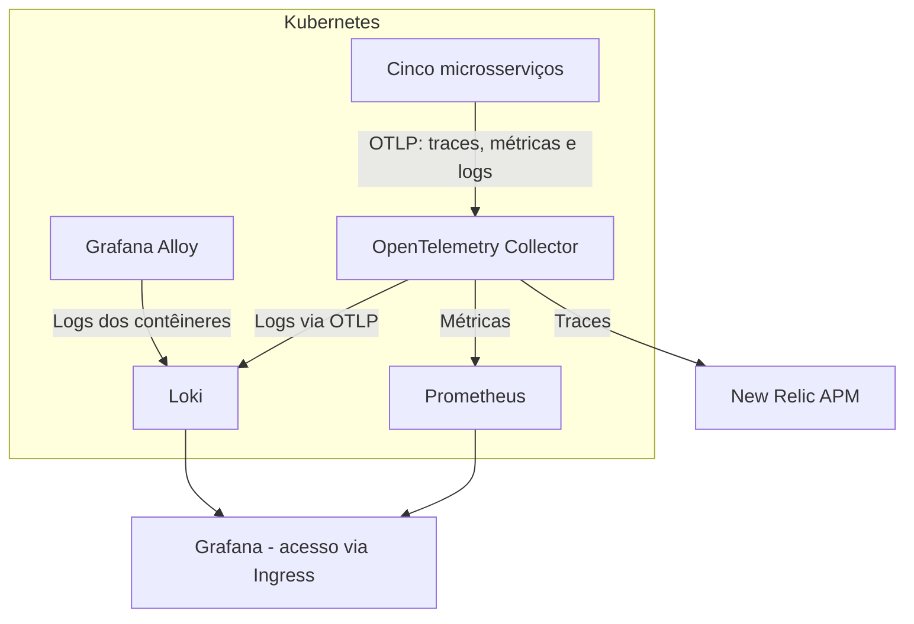

# Toggle Master Microservices - Observabilidade


## **Identificação do Projeto**

- **Projeto:** Toggle Master Microservices
- **Fase:** 04 - Observabilidade
- **Integrantes:** Grupo 68
  - Arthur de Castilho Nascimento - RM371601 - [castartx@gmail.com](mailto:castartx@gmail.com)
  - Gerusa Fernandes Lobo Nogueira - RM367568 - [gerusalobo@gmail.com](mailto:gerusalobo@gmail.com)
  - José Henrique Cavalcanti de Melo Filho -  RM 372074 - [meloricke.bra@gmail.com](mailto:meloricke.bra@gmail.com)
  - Pedro Vinicius Araujo Negreiros - RM372553 - [pedro28vinicius@hotmail.com](mailto:pedro28vinicius@hotmail.com)


## Objetivo do Projeto

A plataforma é composta por cinco microsserviços independentes, mantidos em um monorepo:

| Microsserviço | Linguagem | Responsabilidade e dependências principais |
| --- | --- | --- |
| `auth-service` | Go | Gerencia chaves de API e autenticação; utiliza PostgreSQL. |
| `flag-service` | Python | Mantém as definições de feature flags em PostgreSQL. |
| `targeting-service` | Python | Gerencia regras de segmentação em PostgreSQL. |
| `evaluation-service` | Go | Executa a avaliação de flags no caminho crítico; usa Redis e publica eventos na AWS SQS. |
| `analytics-service` | Python | Consome eventos da SQS e persiste dados analíticos no AWS DynamoDB. |

O objetivo desta fase é instrumentar e observar os serviços e o ambiente Kubernetes, centralizar métricas, logs e traces, facilitar a investigação de falhas e criar alertas que possam acionar uma recuperação controlada.


## Visão Geral

A arquitetura de observabilidade do ToggleMaster foi implementada para centralizar a coleta, o processamento, o armazenamento e a visualização de métricas, logs e traces dos microsserviços executados no Kubernetes.

A solução combina ferramentas open source, integradas ao Kubernetes por meio de Helm charts e GitOps com Argo CD, com o New Relic para Application Performance Monitoring (APM) e Distributed Tracing.

Os principais objetivos são:

- Monitorar a saúde dos recursos do cluster Kubernetes.
- Centralizar os logs dos contêineres.
- Coletar e consultar métricas de infraestrutura e aplicações.
- Rastrear requisições distribuídas entre os microsserviços.
- Identificar falhas e facilitar a análise de problemas.
- Preparar a infraestrutura para dashboards, alertas e mecanismos de recuperação automática.

## Ferramentas utilizadas

| Ferramenta              | Responsabilidade                                             |
| ----------------------- | ------------------------------------------------------------ |
| Prometheus              | Coleta, armazenamento e consulta de métricas.                |
| Loki                    | Armazenamento e consulta centralizada dos logs.              |
| Grafana Alloy           | Descoberta dos pods Kubernetes e coleta dos logs dos contêineres. |
| OpenTelemetry Collector | Recebimento, processamento e encaminhamento da telemetria.   |
| New Relic               | APM, visualização dos serviços e Distributed Tracing.        |
| Helm                    | Instalação e configuração dos componentes de observabilidade. |
| Argo CD                 | Sincronização das configurações declarativas mantidas no Git. |

## Arquitetura de observabilidade

A solução possui dois fluxos complementares para a coleta de logs:

1. O Grafana Alloy descobre os pods do Kubernetes, coleta os logs dos contêineres e os encaminha ao Loki.
2. O OpenTelemetry Collector recebe os logs enviados via OTLP pelos microsserviços instrumentados e os encaminha ao Loki.

Além dos logs, o OpenTelemetry Collector recebe traces e métricas dos microsserviços, processa os dados e os encaminha aos respectivos backends.

### Fluxo da telemetria



O Alloy complementa a coleta de logs dos contêineres, enquanto o OpenTelemetry Collector atua como ponto central de recebimento e roteamento da telemetria enviada pelas aplicações.

## OpenTelemetry Collector

O OpenTelemetry Collector foi configurado como componente central de telemetria da plataforma.

O Collector utiliza receptores OTLP para receber dados por gRPC e HTTP, processadores para controlar o processamento e o agrupamento dos dados, e exportadores para encaminhá-los aos destinos configurados.

Os pipelines estão organizados por tipo de telemetria:

- **Traces:** recebidos via OTLP e exportados ao New Relic.
- **Métricas:** recebidas via OTLP e por coleta Prometheus, com encaminhamento ao Prometheus por `prometheusremotewrite`.
- **Logs:** recebidos via OTLP e exportados ao Loki.

O Collector também utiliza um exportador de diagnóstico (`debug`), útil para inspecionar a telemetria durante a validação e o troubleshooting.

A comunicação dos microsserviços com o Collector utiliza o endpoint interno do Kubernetes:

```
http://opentelemetry-collector.observability.svc.cluster.local:4318
```

O protocolo de exportação configurado nas aplicações é `http/protobuf`.

O endereço depende do ambiente: nos Deployments Kubernetes é usado o DNS interno `opentelemetry-collector.observability.svc.cluster.local:4318`; no Docker Compose local, os serviços usam `otel-collector:4318`. A chave de ingestão do New Relic deve ser entregue ao Collector em runtime, sem ser gravada nos arquivos versionados, nas imagens ou nas variáveis dos microsserviços. O relatório registra o armazenamento da chave em segredo da AWS.

## Centralização de logs com Loki e Alloy

O Loki foi provisionado no namespace `observability`, utilizando armazenamento baseado em filesystem e uma configuração single-binary.

O Grafana Alloy foi configurado para descobrir os pods Kubernetes, coletar os logs dos contêineres, processar as linhas no formato CRI e encaminhá-las ao Loki.

O endpoint utilizado pelo Alloy é:

```
http://loki.observability.svc.cluster.local:3100/loki/api/v1/push
```

A consulta aos logs pode ser realizada pela API do Loki ou por uma interface compatível, como o Grafana.

Exemplo de consulta LogQL para visualizar os logs coletados:

```logql
{job="loki.source.kubernetes.pods"}
```

Exemplo de filtro por microsserviço:

```logql
{job="loki.source.kubernetes.pods", instance=~".*flag-service.*"}
```

Exemplo de pesquisa de mensagens relacionadas a erros:

```logql
{job="loki.source.kubernetes.pods"} |~ "(?i)error|exception|failed"
```

Essas consultas permitem investigar o comportamento das aplicações sem depender exclusivamente dos logs locais de cada pod.

## Instrumentação dos microsserviços

Os cinco microsserviços da plataforma foram configurados para enviar telemetria ao OpenTelemetry Collector:

| Microsserviço        | Linguagem | Porta |
| -------------------- | --------- | ----: |
| `auth-service`       | Go        |  8001 |
| `flag-service`       | Python    |  8002 |
| `targeting-service`  | Python    |  8003 |
| `evaluation-service` | Go        |  8004 |
| `analytics-service`  | Python    |  8005 |

As aplicações Python utilizam bibliotecas do OpenTelemetry e inicialização por `opentelemetry-instrument`, incluindo instrumentação do Flask e integração com logs.

Nos Deployments Kubernetes, foram definidos o endpoint OTLP, o protocolo `http/protobuf` e os exporters de traces, métricas e logs. Também foi configurado o nome de serviço por meio da variável `OTEL_SERVICE_NAME`.

Essas configurações permitem padronizar o envio da telemetria e identificar cada microsserviço nos sistemas de observabilidade.

Os três serviços Python iniciam com auto-instrumentação OpenTelemetry, incluindo instrumentação Flask e exportação de logs pelo Collector. Os dois serviços Go inicializam os SDKs OpenTelemetry diretamente no código e exportam traces, métricas e logs por OTLP. Nos Deployments, `OTEL_SERVICE_NAME` diferencia cada serviço e `DEPLOYMENT_ENVIRONMENT` identifica o ambiente.

No fluxo síncrono, o `evaluation-service` propaga W3C Trace Context nas chamadas HTTP aos serviços de flags e targeting. As operações PostgreSQL de `auth-service` e Redis de `evaluation-service` geram spans quando executadas por clientes instrumentados. Para eventos assíncronos, o produtor de avaliação inclui `traceparent`/`tracestate` nos atributos da mensagem SQS, que o `analytics-service` extrai ao criar o span consumidor.

## APM e Distributed Tracing com New Relic

O New Relic foi integrado ao OpenTelemetry Collector para receber os traces gerados pelas aplicações.

A instrumentação permite observar spans e investigar o caminho das requisições, identificando operações executadas e possíveis pontos de falha ou latência.

Durante a validação, os cinco microsserviços passaram a aparecer no APM & Services com seus nomes correspondentes:

- `auth-service`
- `flag-service`
- `targeting-service`
- `evaluation-service`
- `analytics-service`

Também foram realizadas consultas NRQL para verificar a quantidade de spans por `service.name` no período selecionado. Os resultados demonstraram a chegada de spans recentes associados aos cinco serviços.

Uma entidade anterior identificada como `unknown_service:python3.11` não apresentou spans na consulta da última hora, indicando que não havia telemetria recente associada a esse nome no período consultado.

A validação do Service Map e do caminho completo de uma requisição distribuída deve complementar essa verificação.


Uma consulta usada para verificar a chegada de spans por serviço foi:

```sql
FROM Span
SELECT count(*)
FACET service.name
SINCE 60 minutes ago
```

Em uma execução documentada em 2026-10-09, a consulta de validação de traces encontrou os cinco microsserviços no mesmo trace. A presença de `analytics-service` depende do envio e consumo bem-sucedidos da mensagem SQS; portanto, ela não é garantida em toda requisição síncrona.

## Provisionamento e GitOps

Os componentes de observabilidade são organizados em configurações declarativas no repositório Kubernetes, com instalação e gerenciamento por Helm charts e aplicações Argo CD.

Essa abordagem permite manter a configuração versionada, revisar mudanças por Git e sincronizar os recursos com o cluster sem depender de alterações manuais recorrentes.

As configurações dos componentes ficam organizadas no repositório, incluindo os valores Helm do OpenTelemetry Collector em:

```
helm-values/observability/opentelemetry-collector.yaml
```

O namespace `observability` concentra os componentes de monitoramento, enquanto os microsserviços permanecem no namespace `toggle-prod`.

### CI/CD dos microsserviços

O repositório [tech-challenge-services](../tech-challenge-services/README.md) mantém os cinco serviços e os workflows do GitHub Actions. Workflows individuais chamam um pipeline reutilizável, que executa as verificações e os testes apropriados à linguagem, constrói a imagem Docker e analisa a imagem com Trivy. A publicação no Amazon ECR é habilitada para execuções aprovadas na branch `main`; tags baseadas no commit (`sha-<shortsha>`) dão rastreabilidade à imagem.

A atualização do repositório GitOps é opcional e ocorre por commit no repositório externo; o pipeline não aplica recursos diretamente no cluster nem administra o Argo CD. No estado descrito pelo README, a etapa opcional altera o nome do container no manifesto, não a tag da imagem. Essa integração depende das convenções do repositório GitOps e deve ser tratada como um fluxo separado da implantação dos componentes de observabilidade.

## Service Map
O teste de distributed tracing documentado no runbook confirmou traces recentes relacionando os cinco microsserviços em uma mesma execução. A propagação síncrona conecta `evaluation-service` a `flag-service` e `targeting-service`; operações instrumentadas podem adicionar as dependências PostgreSQL e Redis. O caminho assíncrono pode incluir `analytics-service` quando a mensagem SQS é consumida com sucesso.

Essa validação comprova a propagação de contexto entre serviços, mas não deve ser confundida com uma validação visual completa do Service Map do New Relic. A inclusão dos serviços assíncronos depende do fluxo real da fila e das credenciais AWS válidas.

## Dashboards
O relatório registra o acesso externo ao Grafana e ao Prometheus por URLs publicadas no NGINX Ingress. O Prometheus e o Loki fornecem, respectivamente, métricas e logs para consulta; os READMEs não especificam os painéis, os indicadores ou as regras visuais de cada dashboard.

## Alertas Inteligentes e Self-Healing

### Criação do Alerta

O fluxo de recuperação utiliza um webhook HTTPS do Grafana Alerting, publicado pelo Amazon API Gateway. A notificação deve ser `POST`, incluir `Authorization: Bearer <token>` e fornecer os labels `namespace` e `deployment`. O namespace precisa corresponder ao valor permitido na Lambda. O exemplo de payload e o procedimento de configuração estão no README e no guia de implantação do componente self-healing.

### Gerenciamento de Incidentes

### Notificação (ChatOps)

### Self-Healing

Foi implementada uma função AWS Lambda em Python (`app.handler`) para receber o webhook do Grafana e solicitar o reinício gradual de um Deployment no Amazon EKS. O caminho é: Grafana → API Gateway → Lambda → API Kubernetes do EKS.

A função valida o método HTTP, compara o token Bearer em tempo constante, interpreta JSON simples ou codificado em Base64 e ignora alertas resolvidos ou sem alertas `firing`. Para um alerta em disparo, exige `namespace` e `deployment`, restringe o namespace por `ALLOWED_NAMESPACE` e valida o formato DNS do nome antes de usá-lo na URL da API.

Para autenticar no EKS, a Lambda assina uma solicitação `GetCallerIdentity` do STS com as credenciais IAM do runtime e gera um token temporário. A conexão com a API Kubernetes usa HTTPS e valida o certificado CA do cluster. O reinício é solicitado por um `PATCH` que atualiza `kubectl.kubernetes.io/restartedAt` no pod template; o Kubernetes executa o rolling update conforme a estratégia do Deployment. A resposta confirma o pedido, mas não aguarda o rollout terminar.

O acesso é limitado por duas camadas: a validação de namespace na aplicação e o RBAC do grupo `self-healing`, que concede `patch` e `get` em Deployments no namespace configurado. O token compartilhado do webhook e a role IAM da Lambda são controles distintos: o primeiro autentica o remetente; a segunda fornece identidade AWS para o acesso ao EKS. O endpoint privado do cluster exige conectividade de rede da Lambda, normalmente por VPC.

Por decisão de implementação, a função não exclui pods diretamente: altera o template e deixa a disponibilidade durante o rollout sob controle do Kubernetes. Se o Deployment retornar `404`, a operação é tratada como sem ação necessária. Erros de autorização do Kubernetes são reportados como falha de integração. Se houver vários alertas `firing` no mesmo webhook, somente o primeiro é processado.

As variáveis necessárias incluem `WEBHOOK_BEARER_TOKEN`, `ALLOWED_NAMESPACE`, `EKS_CLUSTER_NAME`, `EKS_CLUSTER_ENDPOINT` e `EKS_CLUSTER_CA_CERTIFICATE_BASE64`; `AWS_REGION` é fornecida pelo runtime Lambda. O guia do componente descreve a role IAM, o mapeamento de acesso EKS, o RBAC, o API Gateway e os requisitos de rede. O pacote da Lambda pode conter somente `app.py`, pois `boto3` e `botocore` estão disponíveis no runtime.

O passo a passo está no [README do componente](../tech-challenge-4-self-healing/README.md) e no [guia de implantação](../tech-challenge-4-self-healing/setup-guide.md).


## Testes
O monorepo dos serviços inclui testes por serviço e um teste de integração de distributed traces. O runbook `docs/runbooks/observability.md` descreve a execução de `scripts/observability/test-distributed-traces.sh`, que verifica via NerdGraph os serviços presentes em um trace recebido pelo New Relic. A validação documentada em 2026-10-09 encontrou os cinco microsserviços; iniciar o Compose ou verificar a saúde do Collector, isoladamente, não comprova ingestão pelo New Relic.

Consulte o [runbook de observabilidade](../tech-challenge-services/docs/runbooks/observability.md) e o [script de validação de traces](../tech-challenge-services/scripts/observability/test-distributed-traces.sh) para os comandos de execução.

O componente self-healing possui testes `pytest` para parsing do webhook, autenticação, validação do alvo, token EKS, conteúdo do `PATCH` e mapeamento de erros. `test_local.py` exercita cenários de smoke test e, por padrão, substitui a chamada ao EKS por uma simulação. O modo `--live` faz chamadas reais e pode reiniciar um Deployment, devendo ser usado somente com credenciais e um cluster apropriado.

Os testes automatizados verificam a lógica com chamadas externas simuladas; eles não substituem a validação de conectividade, permissões IAM/RBAC nem o acompanhamento do rollout em um cluster AWS/EKS.

## Desafios Encontrados

### 1.Limitação de capacidade de pods nos nodes do Kubernetes

**Problema identificado**

Durante a implantação dos node exporters, alguns pods permaneceram no estado `Pending`, impedindo a conclusão do provisionamento de todos os recursos.

As mensagens do Kubernetes indicavam problemas de agendamento, incluindo:

```
0/4 nodes available
Too many pods
```

A investigação mostrou que os nodes micro tem uma limitação de 4 pods o que inviabilizava a implementação do node exporter, considerando os pods das aplicações e os componentes de infraestrutura e observabilidade

Na sequencia ajustamos o tamanho dos nodes para small, dentro do Free Tier, aumentando de 4 para 11 pods por node e diminuindo a quantidade neceśsaria de nodes para 4.

Após essa etapa, e durante a implementação do Grafana Alloy, tivemos um problema similar com limitação de quantidade de pods por node:

As mensagens do Kubernetes indicavam problemas de agendamento, incluindo:

```text
0/4 nodes available
Too many pods
NodeAffinity
```

Ajustamos a configuração de  Deamonset para Deployment de forma a resolver a limitação.

A configuração passou a utilizar:

```
controller:
  type: deployment
  replicas: 1
```

No modo DaemonSet, o Alloy tenta executar uma instância em cada node elegível. No modo Deployment, uma réplica é suficiente para centralizar a coleta configurada, reduzindo a quantidade de pods necessários para esse componente.

Após a alteração, o Argo CD sincronizou a configuração e a aplicação Alloy passou a apresentar estado `Synced/Healthy`. O pod ficou `2/2 Running`, e o pod Alloy que permanecia pendente deixou de ser um bloqueio para a implantação.

**Resultado e justificativa técnica**

A solução reduziu o consumo de vagas de pods sem exigir, naquele momento, a alteração do tipo de instância ou do número de nodes do cluster.

A decisão também demonstrou a importância de avaliar o custo operacional e os limites do ambiente AWS Free Tier ao implantar ferramentas adicionais em um cluster Kubernetes com recursos restritos.

### 2.Comunicação entre os microsserviços e o OpenTelemetry Collector

**Problema**

Durante os testes, alguns microsserviços Python registraram erros de resolução de nome ao tentar enviar telemetria para o endpoint `otel-collector:4318`.

As mensagens indicavam falha de resolução DNS, com erros semelhantes a:

```text
NameResolutionError
HTTPConnectionPool(host='otel-collector', port=4318)
```

Isso impedia que as aplicações estabelecessem comunicação com o endpoint configurado para exportação OTLP.

**Causa identificada**

O hostname configurado nos contêineres não correspondia ao endereço do serviço utilizado pelo OpenTelemetry Collector no Kubernetes. O nome `otel-collector` era utilizado na configuração original dos Dockerfiles, apropriada ao ambiente local, mas não correspondia ao nome completo do serviço Kubernetes implantado no namespace `observability`.

**Solução aplicada**

Os Deployments Kubernetes foram ajustados para utilizar o endereço DNS interno do serviço:

```text
http://opentelemetry-collector.observability.svc.cluster.local:4318
```

Também foi confirmado o uso do protocolo `http/protobuf`.

Após a atualização, os endpoints foram verificados diretamente no ambiente dos contêineres por meio das variáveis de ambiente.

### 3.Padronização das variáveis de ambiente do OpenTelemetry

**Problema**

Mesmo após a configuração dos endpoints, era necessário verificar se os cinco microsserviços estavam utilizando parâmetros compatíveis de exportação e identificação da telemetria.

Uma configuração inconsistente poderia provocar falhas na exportação, ausência de sinais ou identificação incorreta dos serviços.

**Solução aplicada**

Foram conferidas as variáveis de ambiente dos Deployments, incluindo:

```text
OTEL_EXPORTER_OTLP_ENDPOINT
OTEL_EXPORTER_OTLP_PROTOCOL
OTEL_TRACES_EXPORTER
OTEL_METRICS_EXPORTER
OTEL_LOGS_EXPORTER
OTEL_SERVICE_NAME
```

Nos três serviços Python, foram confirmados os nomes `flag-service`, `targeting-service` e `analytics-service`, além do endpoint OTLP e dos exporters configurados.

A validação foi realizada por meio do comando `kubectl exec`, consultando as variáveis efetivamente presentes nos contêineres, em vez de depender exclusivamente dos arquivos declarativos.

### 4.Identificação dos microsserviços no New Relic

**Problema**

Inicialmente, os serviços Python apareceram no APM associados à entidade `unknown_service:python3.11`, enquanto os serviços Go eram identificados pelos nomes esperados.

Isso dificultava a associação da telemetria às aplicações responsáveis pelas operações.

**Investigação e solução**

Foram verificadas as configurações de instrumentação Python, o uso de `opentelemetry-instrument` e as variáveis de ambiente dos Deployments.

A variável `OTEL_SERVICE_NAME` foi confirmada nos três serviços Python.

Posteriormente, após a reinicialização da infraestrutura, os cinco microsserviços passaram a aparecer no New Relic com seus nomes correspondentes.

Para verificar a chegada da telemetria, foi utilizada uma consulta NRQL agrupando spans por nome de serviço:

```sql
FROM Span
SELECT count(*)
FACET service.name
SINCE 60 minutes ago
```

A consulta retornou spans recentes para os cinco microsserviços. Uma consulta separada para `unknown_service:python3.11` retornou zero spans no período analisado.

A telemetria recente passou a ser identificada pelos nomes dos cinco microsserviços. A entidade `unknown_service:python3.11` permaneceu como possível registro histórico, sem atividade recente confirmada.

### 5.Validação dos traces e dos pipelines do Collector

**Problema**

A ausência de dados em determinadas telas do APM não permitia concluir imediatamente se a causa estava na instrumentação das aplicações, na exportação do Collector ou na visualização do New Relic.

**Investigação realizada**

Foram examinados os logs do OpenTelemetry Collector, os endpoints configurados e os pipelines declarados para traces, métricas e logs.

O exportador `debug` estava configurado inicialmente com `verbosity: basic`. Durante a investigação, foi considerada a elevação temporária do nível de detalhe para permitir a inspeção dos atributos da telemetria.

### 6.Centralização dos logs com Loki e Alloy

**Desafio**

Foi necessário estabelecer uma estratégia de coleta de logs que funcionasse para os pods Kubernetes e, ao mesmo tempo, permitisse encaminhar logs enviados pelas aplicações via OTLP.

**Solução aplicada**

O Grafana Alloy foi configurado para descobrir os pods Kubernetes, coletar os logs dos contêineres, processar o formato CRI e encaminhar os registros ao Loki.

Paralelamente, o OpenTelemetry Collector foi configurado com um pipeline de logs que recebe dados OTLP e os exporta ao Loki.

Dessa forma, existem dois caminhos de ingestão de logs:

- Coleta dos logs dos contêineres pelo Alloy.
- Recebimento dos logs instrumentados das aplicações pelo OpenTelemetry Collector.

Essa abordagem permite centralizar logs de contêineres mesmo quando uma aplicação não exporta logs por OTLP, enquanto preserva o pipeline padronizado de telemetria das aplicações instrumentadas.

**Consultas utilizadas**

A coleta foi verificada com consultas à API do Loki e pesquisas por nomes dos microsserviços e mensagens presentes nos registros.

Exemplo de consulta LogQL:

```logql
{job="loki.source.kubernetes.pods"}
```

Exemplo de filtro por serviço:

```logql
{job="loki.source.kubernetes.pods", instance=~".*flag-service.*"}
```

**Ponto de atenção**

Os rótulos observados inicialmente incluíam `job` e `service_name` associados ao componente de coleta, e o rótulo `instance` continha informações sobre o pod e o contêiner. Isso funciona para consultas, mas pode ser refinado para facilitar filtros por namespace, microsserviço e ambiente.

Também é necessário evitar duplicidade de registros caso os mesmos eventos sejam enviados simultaneamente pelo Alloy e pelo pipeline OTLP.

### 7.Integração dos componentes com GitOps

**Desafio**

A solução exige manter os componentes de observabilidade e as configurações dos microsserviços coerentes com o estado declarado no Git, evitando dependência de alterações manuais no cluster.

**Estratégia adotada**

Os componentes foram organizados em configurações declarativas e Helm charts gerenciados por aplicações Argo CD. As alterações de configuração são feitas no repositório, versionadas e sincronizadas com o cluster.

Esse processo facilita a revisão das mudanças, a reprodução da infraestrutura e a rastreabilidade das configurações utilizadas.

### 8.Licence Key do new Relic

Foi criada uma secret na AWS Secret com a License Key do New Relic, de forma a manter a segurança e todas as secrets no mesmo local.

### 9.Ingress para Grafana e Prometheus

Configuramos o acesso externo ao grafana e Prometheus instalado no Cluster, via url do nginx ingress.


## Video de Apresentação

