# Toggle Master Microservices - Observabilidade


## **Identificação do Projeto**

- **Projeto:** Toggle Master Microservices
- **Fase:** 04 - Observabilidade
- **Integrantes:** Grupo 68
  - Arthur de Castilho Nascimento - RM371601 - [castartx@gmail.com](mailto:castartx@gmail.com)
  - Gerusa Fernandes Lobo Nogueira - RM367568 - [gerusalobo@gmail.com](mailto:gerusalobo@gmail.com)
  - José Henrique Cavalcanti de Melo Filho -  RM 372074 - [meloricke.bra@gmail.com](mailto:meloricke.bra@gmail.com)
  - Pedro Vinicius Araujo Negreiros - RM372553 - [pedro28vinicius@hotmail.com](mailto:pedro28vinicius@hotmail.com)

## Repositórios:

- O código das aplicações e testes automatizados estão no repositório: https://github.com/castilhoarth/tech-challenge-services
- Os Manifestos do K8s estão no repositório: https://github.com/castilhoarth/tech-challenge-3-k8s
- E os Manifestos do Terraform, no repositório: https://github.com/castilhoarth/tech-challenge-3-terraform

## Objetivo do Projeto

A plataforma é composta por cinco microsserviços independentes, mantidos em um monorepo:

| Microsserviço        | Linguagem | Responsabilidade e dependências principais                   |
| -------------------- | --------- | ------------------------------------------------------------ |
| `auth-service`       | Go        | Gerencia chaves de API e autenticação; utiliza PostgreSQL.   |
| `flag-service`       | Python    | Mantém as definições de feature flags em PostgreSQL.         |
| `targeting-service`  | Python    | Gerencia regras de segmentação em PostgreSQL.                |
| `evaluation-service` | Go        | Executa a avaliação de flags no caminho crítico; usa Redis e publica eventos na AWS SQS. |
| `analytics-service`  | Python    | Consome eventos da SQS e persiste dados analíticos no AWS DynamoDB. |

O objetivo desta fase é instrumentar e observar os serviços e o ambiente Kubernetes, centralizar métricas, logs e traces, facilitar a investigação de falhas e criar alertas que possam acionar uma recuperação controlada.


## Visão Geral

A arquitetura de observabilidade do ToggleMaster foi implementada para centralizar a coleta, o processamento, o armazenamento e a visualização de métricas, logs e traces dos microsserviços executados no Kubernetes.

A solução combina ferramentas open source integradas ao Kubernetes, utilizando Helm para instalação e Argo CD para gerenciamento GitOps, com o New Relic para Application Performance Monitoring (APM) e Distributed Tracing.

Os principais objetivos são:

- Monitorar a saúde dos recursos do cluster Kubernetes.
- Centralizar os logs dos contêineres.
- Coletar e consultar métricas de infraestrutura e aplicações.
- Rastrear requisições distribuídas entre os microsserviços.
- Identificar falhas e facilitar a análise de problemas.
- Monitorar latência e disponibilidade das aplicações.
- Gerar alertas com diferentes níveis de severidade.
- Integrar o gerenciamento de alertas ao Jira Service Management Operations.
- Acionar a equipe de on-call via Slack.
- Implementar mecanismos de recuperação automática (Self-Healing).

## Ferramentas utilizadas

| Ferramenta                         | Responsabilidade                                             |
| ---------------------------------- | ------------------------------------------------------------ |
| Prometheus                         | Coleta, armazenamento e consulta de métricas.                |
| Loki                               | Armazenamento e consulta centralizada dos logs.              |
| Grafana Alloy                      | Descoberta dos pods Kubernetes e coleta dos logs dos contêineres. |
| Grafana                            | Visualização de métricas e logs, configuração de alertas e integração com os mecanismos de notificação e recuperação. |
| Grafana Alert Rules                | Definição de condições, limites, severidades e acionamento dos alertas. |
| OpenTelemetry Collector            | Recebimento, processamento e encaminhamento de métricas, logs e traces. |
| New Relic                          | APM, visualização de serviços, análise de desempenho e Distributed Tracing. |
| Blackbox Exporter                  | Verificação de disponibilidade e resposta HTTP dos endpoints dos microsserviços. |
| Helm                               | Instalação e configuração dos componentes de observabilidade. |
| Argo CD                            | Sincronização das configurações declarativas mantidas no Git. |
| Terraform                          | Provisionamento da infraestrutura AWS, IAM, recursos de integração e Lambda. |
| AWS Lambda                         | Execução da automação de Self-Healing.                       |
| API Gateway                        | Exposição do endpoint HTTP que recebe os webhooks de recuperação do Grafana e aciona o Lambda. |
| Jira Service Management Operations | Gerenciamento de alertas, incidentes, prioridades e escalonamento de on-call. |
| Slack                              | Recebimento das notificações e comunicação da equipe de on-call. |

## Arquitetura de observabilidade

A solução possui dois fluxos complementares para coleta de logs:

1. O Grafana Alloy descobre os pods do Kubernetes, coleta os logs dos contêineres e os encaminha ao Loki.
2. O OpenTelemetry Collector recebe os logs enviados via OTLP pelos microsserviços instrumentados e os encaminha ao Loki.

Além dos logs, o OpenTelemetry Collector recebe traces e métricas dos microsserviços, além de realizar scrapes de métricas de infraestrutura e disponibilidade, processando e encaminhando os dados aos respectivos backends.

### Fluxo da telemetria

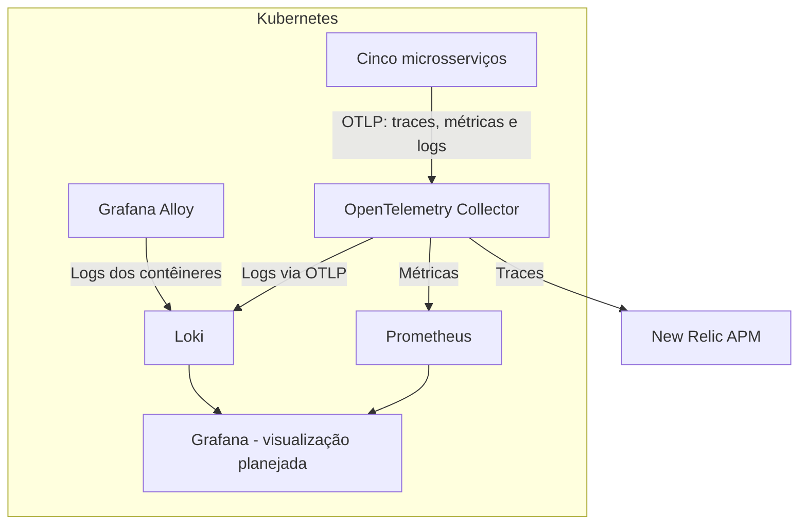

O Alloy complementa a coleta de logs dos contêineres, enquanto o OpenTelemetry Collector atua como ponto central de recebimento e roteamento da telemetria enviada pelas aplicações.

## OpenTelemetry Collector

O OpenTelemetry Collector foi configurado como componente central de telemetria da plataforma.

O Collector utiliza receptores OTLP para receber dados por gRPC e HTTP, processadores para controlar o processamento e agrupamento dos dados, e exportadores para encaminhá-los aos destinos configurados.

Os pipelines estão organizados por tipo de telemetria:

- **Traces:** recebidos via OTLP e exportados ao New Relic.
- **Métricas:** recebidas via OTLP e por coleta Prometheus, com encaminhamento ao Prometheus.
- **Logs:** recebidos via OTLP e exportados ao Loki.

O Collector também utiliza um exportador de diagnóstico (`debug`), útil para inspecionar a telemetria durante a validação e o troubleshooting.

A comunicação dos microsserviços com o Collector utiliza o endpoint interno do Kubernetes:

```
http://opentelemetry-collector.observability.svc.cluster.local:4318
```

O protocolo de exportação configurado nas aplicações é `http/protobuf`.

Embora o Collector receba a telemetria dos serviços pelo mesmo endpoint OTLP, a instrumentação variou conforme a linguagem. Nos serviços Python, foi possível utilizar a auto-instrumentação do OpenTelemetry, iniciada por `opentelemetry-instrument`. Já nos serviços Go, foi necessário alterar o código para inicializar os SDKs do OpenTelemetry e configurar a exportação da telemetria. Assim, o Collector centraliza o recebimento, mas cada linguagem exigiu uma abordagem própria na aplicação.

### Monitoramento de Infraestrutura

O OpenTelemetry Collector utiliza o receiver Prometheus para realizar scrapes das métricas de infraestrutura.

O job `node-exporter-via-otel` coleta métricas dos pods do Prometheus Node Exporter, permitindo monitorar recursos e condições dos nodes Kubernetes.

### Monitoramento de Disponibilidade dos Microsserviços

Foi configurado um job denominado `blackbox-health-via-otel` no OpenTelemetry Collector, utilizando o receiver Prometheus para coletar métricas de disponibilidade dos microsserviços.

O Blackbox Exporter realiza probes HTTP nos endpoints `/health` dos cinco microsserviços, verificando a disponibilidade e o retorno das aplicações.

O Collector realiza o scrape dessas métricas a cada 30 segundos e as encaminha ao Prometheus, permitindo acompanhar a disponibilidade dos serviços e utilizar os dados na construção de dashboards e regras de alerta.

Endpoints monitorados:

| Microsserviço      | Endpoint                                                     |
| ------------------ | ------------------------------------------------------------ |
| auth-service       | `http://auth-service.toggle-prod.svc.cluster.local:8001/health` |
| flag-service       | `http://flag-service.toggle-prod.svc.cluster.local:8002/health` |
| targeting-service  | `http://targeting-service.toggle-prod.svc.cluster.local:8003/health` |
| evaluation-service | `http://evaluation-service.toggle-prod.svc.cluster.local:8004/health` |
| analytics-service  | `http://analytics-service.toggle-prod.svc.cluster.local:8005/health` |

O Blackbox Exporter está disponível internamente pelo endpoint:

```
blackbox-exporter-prometheus-blackbox-exporter.observability.svc.cluster.local:9115
```


## Centralização de logs com Loki e Alloy

O Loki foi provisionado no namespace `observability`, utilizando armazenamento baseado em filesystem e configuração single-binary.

O Grafana Alloy foi configurado para descobrir os pods Kubernetes, coletar os logs dos contêineres, processar as linhas no formato CRI e encaminhá-las ao Loki.

O endpoint utilizado pelo Alloy é:

```
http://loki.observability.svc.cluster.local:3100/loki/api/v1/push
```

A consulta aos logs pode ser realizada pela API do Loki ou por uma interface compatível, como o Grafana.

Exemplo de consulta LogQL para visualizar os logs coletados:

```logql
{job="loki.source.kubernetes.pods"}
```

Exemplo de filtro por microsserviço:

```logql
{job="loki.source.kubernetes.pods", instance=~".*flag-service.*"}
```

Exemplo de pesquisa de mensagens relacionadas a erros:

```logql
{job="loki.source.kubernetes.pods"} |~ "(?i)error|exception|failed"
```

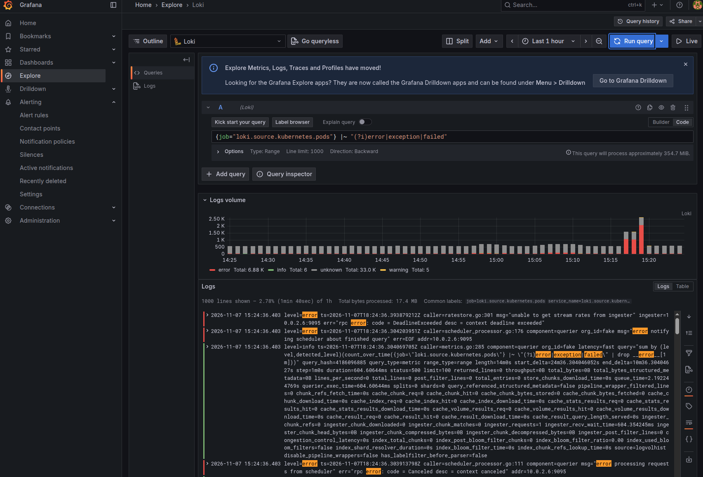

Essas consultas permitem investigar o comportamento das aplicações sem depender exclusivamente dos logs locais de cada pod.

## Instrumentação dos Microsserviços

Os cinco microsserviços da plataforma foram configurados para enviar telemetria ao OpenTelemetry Collector.

| Microsserviço        | Linguagem | Porta |
| -------------------- | --------- | ----: |
| `auth-service`       | Go        |  8001 |
| `flag-service`       | Python    |  8002 |
| `targeting-service`  | Python    |  8003 |
| `evaluation-service` | Go        |  8004 |
| `analytics-service`  | Python    |  8005 |

As aplicações Python utilizam bibliotecas do OpenTelemetry e inicialização por `opentelemetry-instrument`, incluindo instrumentação do Flask e integração com logs.

Nos Deployments Kubernetes, foram definidos o endpoint OTLP, o protocolo `http/protobuf` e os exporters de traces, métricas e logs. Também foi configurado o nome de serviço por meio da variável `OTEL_SERVICE_NAME`.

Essas configurações permitem padronizar o envio da telemetria e identificar cada microsserviço nos sistemas de observabilidade.

Os três serviços Python iniciam com auto-instrumentação OpenTelemetry, incluindo instrumentação Flask e exportação de logs pelo Collector. Os dois serviços Go inicializam os SDKs OpenTelemetry diretamente no código e exportam traces, métricas e logs por OTLP. Nos Deployments, `OTEL_SERVICE_NAME` diferencia cada serviço e `DEPLOYMENT_ENVIRONMENT` identifica o ambiente.

```yaml
env:
  - name: OTEL_EXPORTER_OTLP_ENDPOINT
    value: "http://opentelemetry-collector.observability.svc.cluster.local:4318"
  - name: DEPLOYMENT_ENVIRONMENT
    value: "production"
```

No fluxo síncrono, o `evaluation-service` propaga W3C Trace Context nas chamadas HTTP aos serviços de flags e targeting. As operações PostgreSQL de `auth-service` e Redis de `evaluation-service` geram spans quando executadas por clientes instrumentados. Para eventos assíncronos, o produtor de avaliação inclui `traceparent`/`tracestate` nos atributos da mensagem SQS, que o `analytics-service` extrai ao criar o span consumidor.


## APM e Distributed Tracing com New Relic

O New Relic foi integrado ao OpenTelemetry Collector para receber os traces gerados pelas aplicações.

A instrumentação permite observar spans e investigar o caminho das requisições, identificando operações executadas e possíveis pontos de falha ou latência.

Durante a validação, os cinco microsserviços passaram a aparecer no APM & Services com seus nomes correspondentes:

- `auth-service`
- `flag-service`
- `targeting-service`
- `evaluation-service`
- `analytics-service`

Também foram realizadas consultas NRQL para verificar a quantidade de spans por `service.name` no período selecionado.

Exemplo de consulta:

```sql
FROM Span
SELECT count(*)
FACET service.name
SINCE 60 minutes ago
```

Os resultados demonstraram a chegada de spans recentes associados aos cinco serviços.

Uma entidade anterior identificada como `unknown_service:python3.11` não apresentou spans na consulta da última hora, indicando que não havia telemetria recente associada a esse nome no período consultado.

A validação do Service Map e do caminho completo de uma requisição distribuída complementa essa verificação, permitindo visualizar as dependências e interações entre os microsserviços.

Em uma execução documentada em 2026-10-09, a consulta de validação de traces encontrou os cinco microsserviços no mesmo trace. A presença de `analytics-service` depende do envio e consumo bem-sucedidos da mensagem SQS; portanto, ela não é garantida em toda requisição síncrona.

#### Distributed Tracing

`auth-service`

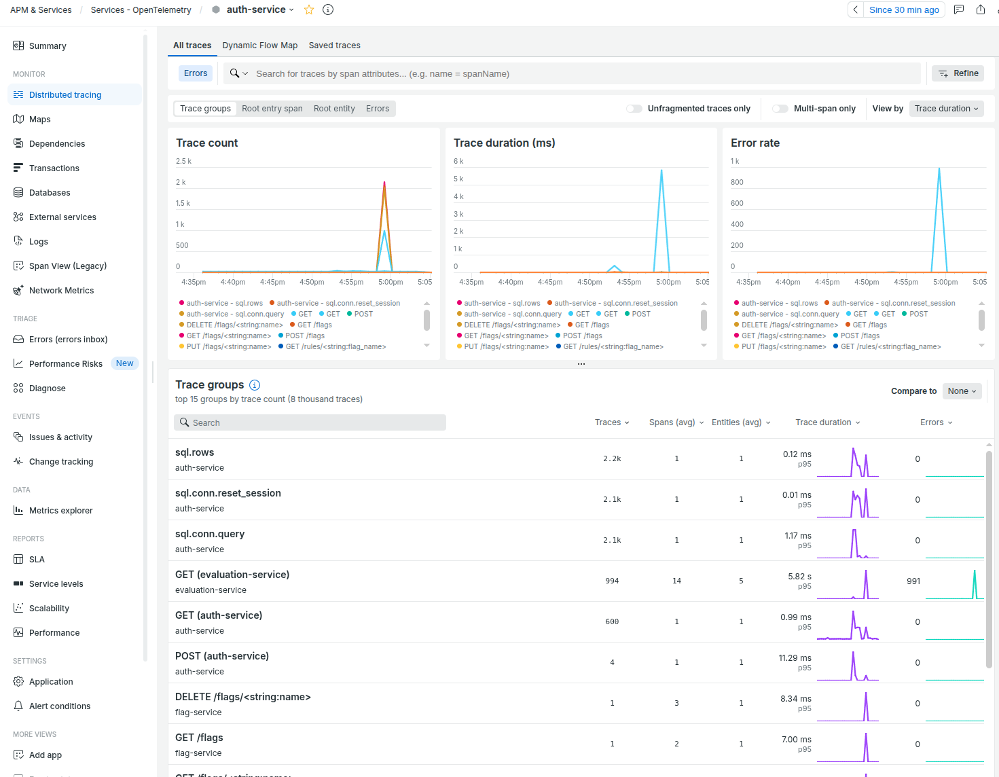

`flag-service`

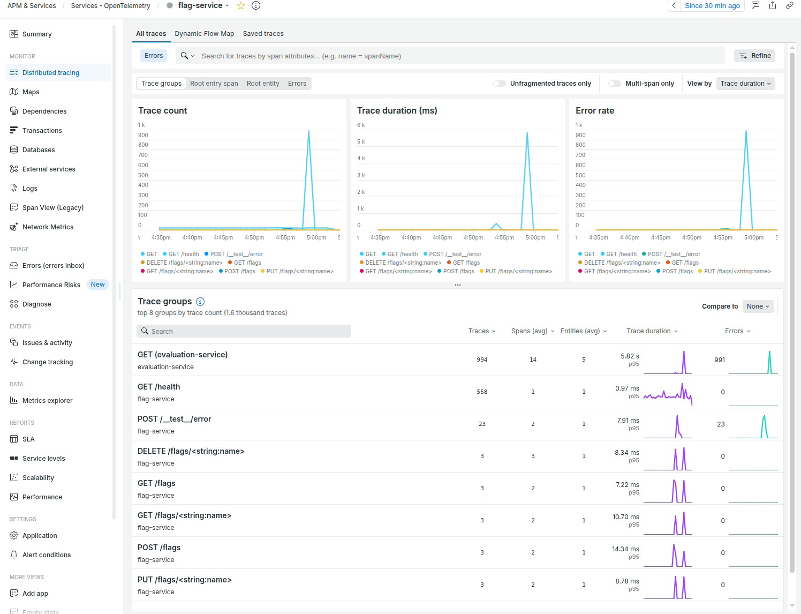

`targeting-service`

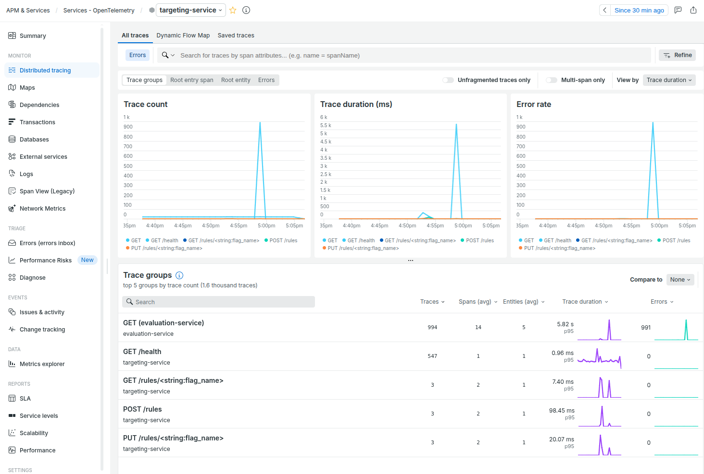

`evaluation-service`

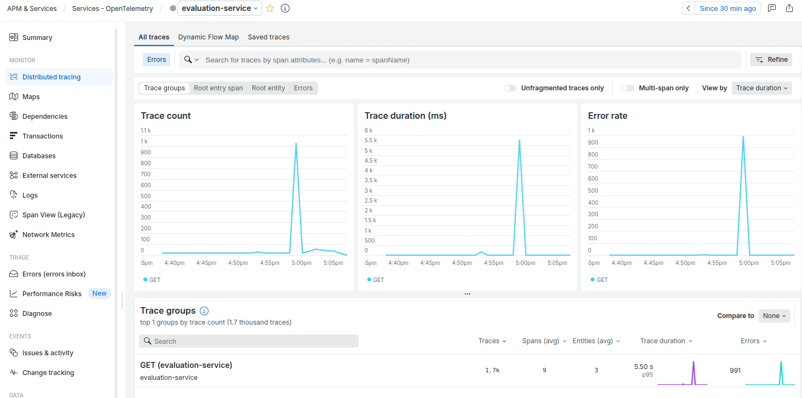

`analytics-service`


#### Service Map

O teste de distributed tracing documentado no runbook confirmou traces recentes relacionando os cinco microsserviços em uma mesma execução. A propagação síncrona conecta `evaluation-service` a `flag-service` e `targeting-service`; operações instrumentadas podem adicionar as dependências PostgreSQL e Redis. O caminho assíncrono pode incluir `analytics-service` quando a mensagem SQS é consumida com sucesso.

Essa validação comprova a propagação de contexto entre serviços, mas não deve ser confundida com uma validação visual completa do Service Map do New Relic. A inclusão dos serviços assíncronos depende do fluxo real da fila e das credenciais AWS válidas.

`auth-service`


`flag-service`

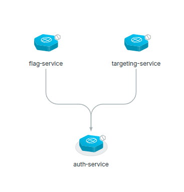

`targeting-service`

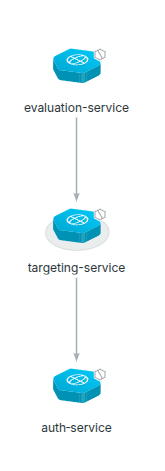

`evaluation-service`

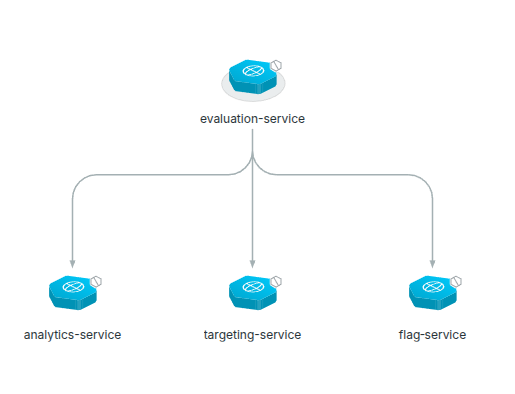

`analytics-service`

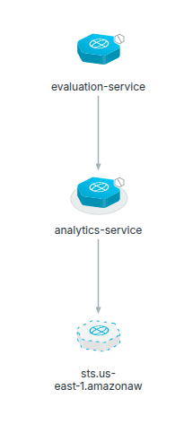

## Provisionamento e GitOps

Os componentes de observabilidade são organizados em configurações declarativas no repositório Kubernetes, com instalação e gerenciamento por Helm charts e aplicações Argo CD.

Essa abordagem permite manter a configuração versionada, revisar mudanças por Git e sincronizar os recursos com o cluster sem depender de alterações manuais recorrentes.

As configurações dos componentes ficam organizadas no repositório, incluindo os valores Helm do OpenTelemetry Collector em:

```
helm-values/observability/opentelemetry-collector.yaml
```

O namespace `observability` concentra os componentes de monitoramento, enquanto os microsserviços permanecem no namespace `toggle-prod`.

As configurações de Dashboards, alertas e integrações do Grafana, sobem via ARGO-CD na infraestrutura.

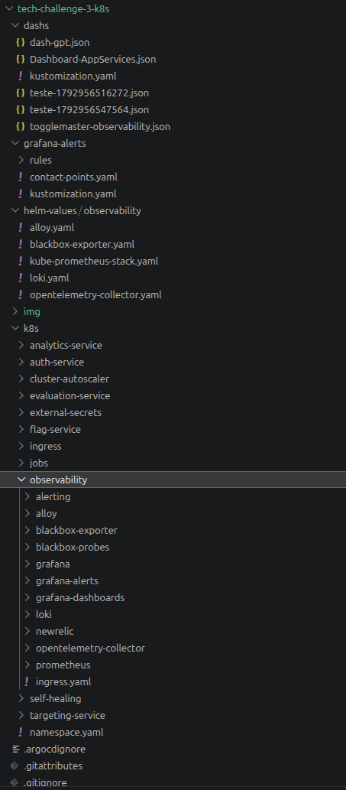

O Lambda para o self healing, assim como alguns IAM e AWS secrets necessários para as integrações do Grafana foram implementados via Terraform na infra-estrutura pre-existente.

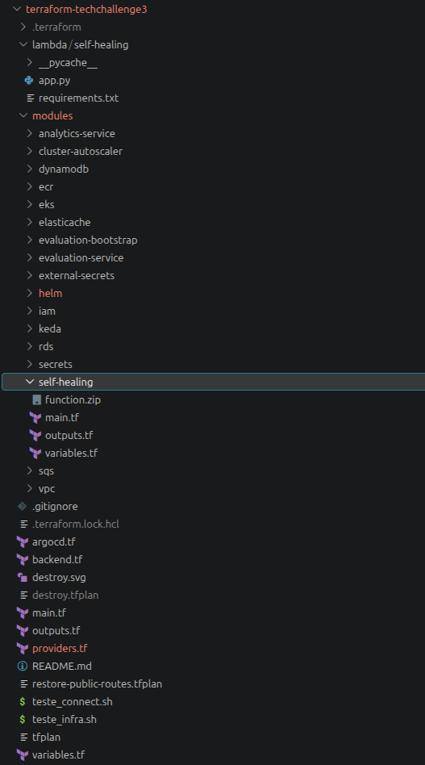

#### CI/CD dos microsserviços

O repositório [tech-challenge-services](../tech-challenge-services/README.md) mantém os cinco serviços e os workflows do GitHub Actions. Workflows individuais chamam um pipeline reutilizável, que executa as verificações e os testes apropriados à linguagem, constrói a imagem Docker e analisa a imagem com Trivy. A publicação no Amazon ECR é habilitada para execuções aprovadas na branch `main`; tags baseadas no commit (`sha-<shortsha>`) dão rastreabilidade à imagem.

A atualização do repositório GitOps é opcional e ocorre por commit no repositório externo; o pipeline não aplica recursos diretamente no cluster nem administra o Argo CD. No estado descrito pelo README, a etapa opcional altera o nome do container no manifesto, não a tag da imagem. Essa integração depende das convenções do repositório GitOps e deve ser tratada como um fluxo separado da implantação dos componentes de observabilidade.

#### Testes

O monorepo dos serviços inclui testes por serviço e um teste de integração de distributed traces. O runbook `docs/runbooks/observability.md` descreve a execução de `scripts/observability/test-distributed-traces.sh`, que verifica via NerdGraph os serviços presentes em um trace recebido pelo New Relic. A validação documentada em 2026-10-09 encontrou os cinco microsserviços; iniciar o Compose ou verificar a saúde do Collector, isoladamente, não comprova ingestão pelo New Relic.

Consulte o [runbook de observabilidade](https://github.com/castilhoarth/tech-challenge-3-k8s/blob/feature/tech-challenge-services/docs/runbooks/observability.md) e o [script de validação de traces](https://github.com/castilhoarth/tech-challenge-3-k8s/blob/feature/tech-challenge-services/scripts/observability/test-distributed-traces.sh) para os comandos de execução.

O componente self-healing possui testes `pytest` para parsing do webhook, autenticação, validação do alvo, token EKS, conteúdo do `PATCH` e mapeamento de erros. `test_local.py` exercita cenários de smoke test e, por padrão, substitui a chamada ao EKS por uma simulação. O modo `--live` faz chamadas reais e pode reiniciar um Deployment, devendo ser usado somente com credenciais e um cluster apropriado.

Os testes automatizados verificam a lógica com chamadas externas simuladas; eles não substituem a validação de conectividade, permissões IAM/RBAC nem o acompanhamento do rollout em um cluster AWS/EKS.

## Relatórios e Dashboards

Foi configurado o Ingress NGINX para expor externamente as interfaces do Grafana e Prometheus, permitindo acesso aos dashboards, métricas e ferramentas de análise sem depender exclusivamente de acesso interno ao cluster.

### Prometheus

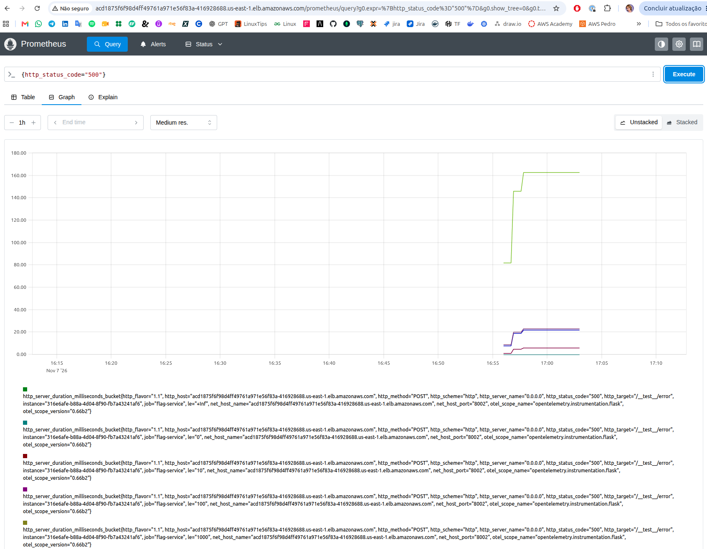


### Dashboard de Observabilidade – Observability / Overview

O dashboard **Observability / Overview** foi desenvolvido no Grafana para centralizar a visualização das principais métricas da plataforma ToggleMaster. A solução integra Prometheus e Loki, permitindo acompanhar disponibilidade, desempenho HTTP, consumo de recursos Kubernetes e logs dos microsserviços.

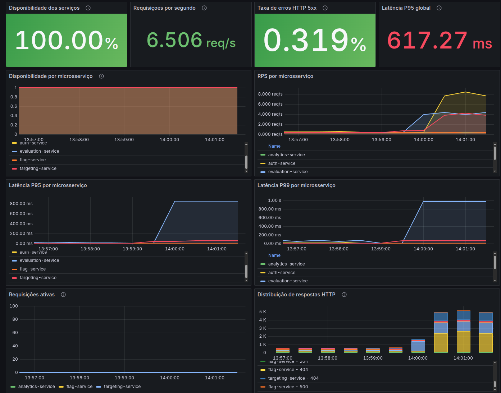

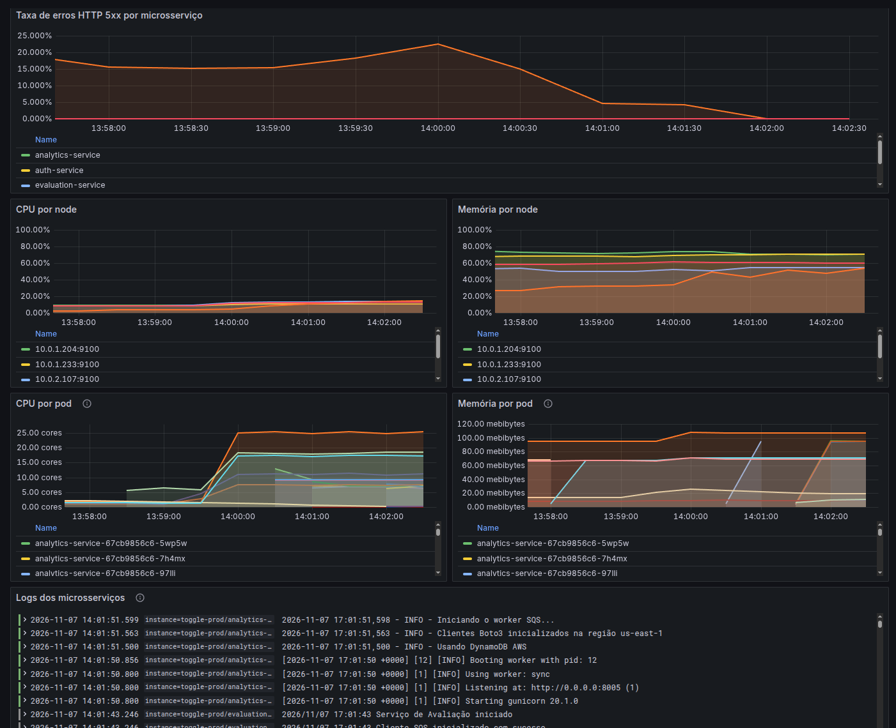

O dashboard possui atualização automática a cada 30 segundos e disponibiliza filtros por microsserviço e pod, facilitando a análise individual dos componentes.

##### 1. Indicadores gerais

Na parte superior do dashboard estão disponíveis quatro indicadores consolidados:

| Painel                       | Métrica                                    | Descrição                                                    |
| ---------------------------- | ------------------------------------------ | ------------------------------------------------------------ |
| Disponibilidade dos serviços | `probe_success`                            | Percentual de endpoints HTTP disponíveis, baseado nas sondagens do Blackbox Exporter. |
| Requisições por segundo      | `http_server_duration_milliseconds_count`  | Volume total de requisições HTTP por segundo, calculado sobre os últimos 15 minutos. |
| Taxa de erros HTTP 5xx       | HTTP 5xx / total de requisições            | Percentual de respostas HTTP 5xx nos últimos 15 minutos.     |
| Latência P95 global          | `http_server_duration_milliseconds_bucket` | Percentil 95 do tempo de resposta HTTP, em milissegundos, considerando os últimos 15 minutos. |

Esses indicadores permitem obter uma visão rápida da disponibilidade, volume de tráfego, ocorrência de erros e desempenho geral da plataforma.

##### 2. Disponibilidade por microsserviço

O painel apresenta a disponibilidade individual dos endpoints de health dos cinco microsserviços:

- auth-service
- flag-service
- targeting-service
- evaluation-service
- analytics-service

A métrica `probe_success` representa o resultado das verificações HTTP realizadas pelo Blackbox Exporter:

- `1`: endpoint disponível.
- `0`: endpoint indisponível ou sondagem malsucedida.

O gráfico permite identificar períodos de indisponibilidade e comparar o comportamento dos serviços ao longo do tempo.

##### 3. RPS por microsserviço

O painel **RPS por microsserviço** apresenta a taxa de requisições HTTP por segundo de cada aplicação.

A métrica é calculada utilizando a taxa de incremento do contador de requisições:

```
sum by (job) (
  rate(http_server_duration_milliseconds_count{job=~"$service"}[5m])
)
```

O resultado permite acompanhar o volume de tráfego individualmente e identificar diferenças de utilização entre os microsserviços.

##### 4. Latência P95 e P99 por microsserviço

Foram implementados dois painéis para análise da distribuição dos tempos de resposta:

- **Latência P95 por microsserviço:** apresenta o tempo de resposta abaixo do qual 95% das requisições estão concentradas.
- **Latência P99 por microsserviço:** apresenta o tempo de resposta abaixo do qual 99% das requisições estão concentradas.

Ambos utilizam histogramas de duração HTTP e permitem comparar o desempenho dos microsserviços ao longo do tempo.

O P95 fornece uma visão do comportamento da maior parte das requisições, enquanto o P99 permite observar a experiência das requisições mais lentas e identificar possíveis degradações.

##### 5. Requisições ativas

O painel **Requisições ativas** apresenta a quantidade de requisições HTTP em processamento simultaneamente.

A métrica utilizada é:

```
sum by (job) (
  http_server_active_requests{job=~"$service"}
)
```

Esse indicador permite acompanhar o volume de requisições em andamento nos serviços que disponibilizam essa instrumentação.

A disponibilidade da métrica depende da instrumentação de cada microsserviço.

##### 6. Distribuição de respostas HTTP

O painel apresenta a quantidade de respostas HTTP por código de status, agrupadas por microsserviço.

São utilizados os códigos de resposta HTTP para identificar o comportamento das aplicações, permitindo observar a distribuição entre respostas de sucesso e erros.

A consulta utiliza o incremento do contador de requisições nos últimos cinco minutos:

```
sum by (job, http_status_code) (
  increase(http_server_duration_milliseconds_count{job=~"$service"}[5m])
)
```

Esse painel permite identificar alterações no comportamento das aplicações, como aumento de respostas HTTP 4xx ou 5xx.

##### 7. Taxa de erros HTTP 5xx por microsserviço

O painel apresenta o percentual de respostas HTTP 5xx individualmente para cada microsserviço.

A métrica considera a proporção entre requisições com status 5xx e o total de requisições no período de cinco minutos.

Esse indicador permite identificar falhas internas das aplicações e comparar a ocorrência de erros entre os serviços.

##### 8. CPU e memória por node

O dashboard disponibiliza painéis de utilização de recursos dos nodes Kubernetes, utilizando métricas coletadas pelo Node Exporter e encaminhadas ao Prometheus.

**CPU por node**

Apresenta o percentual de utilização de CPU de cada node, calculado a partir do tempo em modo idle.

**Memória por node**

Apresenta o percentual de memória utilizada em cada node, considerando a memória disponível em relação à memória total.

Esses indicadores permitem acompanhar a utilização dos recursos computacionais do cluster e identificar possíveis limitações de capacidade.

##### 9. CPU e memória por pod

Os painéis de recursos por pod permitem analisar o consumo individual dos workloads do namespace `toggle-prod`.

**CPU por pod**

Apresenta o consumo de CPU dos containers agrupado por pod, convertido para millicores.

**Memória por pod**

Apresenta a memória working set utilizada pelos containers, agrupada por pod e expressa em MiB.

Esses painéis permitem identificar os pods com maior consumo de recursos e apoiar análises relacionadas à escalabilidade e utilização da infraestrutura.

##### 10. Logs dos microsserviços

O dashboard possui um painel de logs integrado ao Loki, permitindo consultar os registros coletados pelo Grafana Alloy.

A consulta inicial utiliza o label `instance` para filtrar os logs relacionados ao namespace `toggle-prod`.

O painel permite:

- Visualizar logs em ordem cronológica inversa.
- Consultar os registros com timestamps.
- Expandir detalhes das mensagens.
- Visualizar labels associados aos logs.
- Investigar ocorrências de erros e eventos operacionais.

A integração entre os logs e as métricas do dashboard permite correlacionar eventos das aplicações com alterações de desempenho ou disponibilidade.

##### 11. Filtros e atualização

O dashboard disponibiliza dois filtros dinâmicos:

| Filtro        | Descrição                                                    |
| ------------- | ------------------------------------------------------------ |
| Microsserviço | Permite selecionar um ou mais valores do label `job` das métricas HTTP, incluindo a opção de visualizar todos os serviços. |
| Pod           | Permite selecionar pods do namespace `toggle-prod`, aplicando o filtro aos painéis de CPU e memória por pod. |

O dashboard possui atualização automática a cada 30 segundos, com intervalo de visualização inicial de uma hora, permitindo acompanhar o comportamento recente da plataforma.

#### Resultado

O dashboard **Observability / Overview** centraliza os principais indicadores operacionais da ToggleMaster, permitindo acompanhar:

- Disponibilidade dos microsserviços.
- Volume de requisições HTTP.
- Latência P95 e P99.
- Taxa de erros HTTP 5xx.
- Requisições em processamento.
- Distribuição de respostas HTTP.
- Consumo de CPU e memória dos nodes e pods.
- Logs dos microsserviços.

Essa visão consolidada facilita a identificação de indisponibilidades, degradações de desempenho e problemas relacionados ao consumo de recursos, apoiando a investigação de incidentes e as ações de operação da plataforma.

### Dashboard Toggle Services – Observability

O dashboard **Toggle Services – Observability** (`Dashboard-AppServices.json`) foi criado para acompanhar a saúde e o comportamento das aplicações da plataforma Toggle no ambiente de produção (`toggle-prod`). O dashboard concentra indicadores de consumo de CPU e memória, utilização dos limites de recursos configurados e ocorrência de erros HTTP 500.

Cada painel possui thresholds (limites de cor) configurados que funcionam como alertas visuais: à medida que os valores ultrapassam os limites definidos, as cores mudam de verde para amarelo, laranja e vermelho, sinalizando níveis crescentes de atenção. Essa configuração permite identificar rapidamente situações que exigem investigação sem depender exclusivamente das regras de alerta do Grafana.

O dashboard possui atualização a cada 5 minutos (`now-5m`).

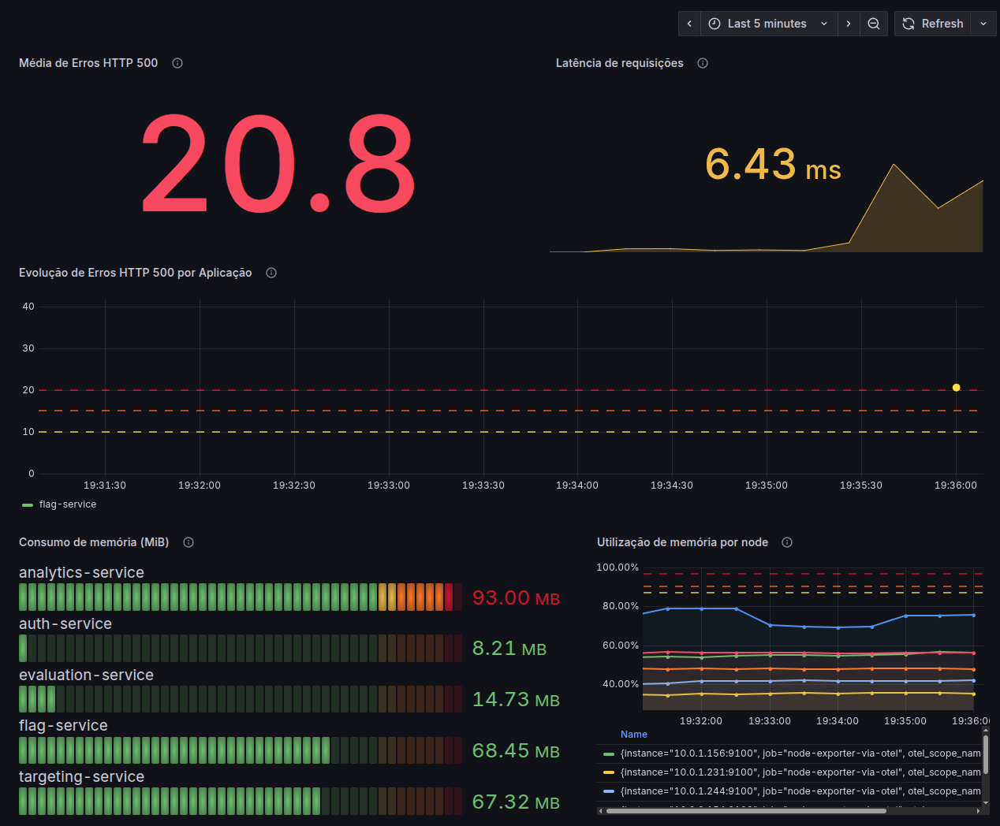

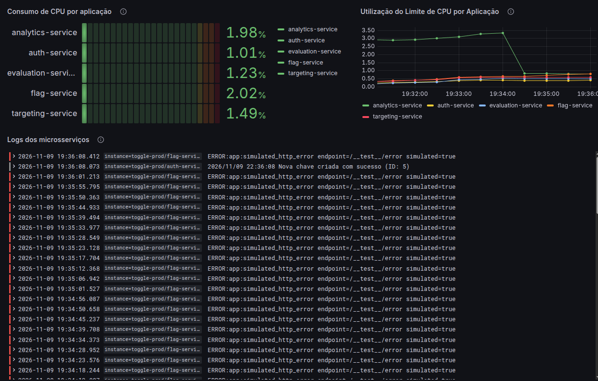


##### 1. Média de Erros HTTP 500

Painel do tipo `stat` que exibe a quantidade média de respostas HTTP 500 registradas por aplicação nos últimos 5 minutos, permitindo uma consulta rápida da ocorrência de erros recentes.

Consulta PromQL:

```
sum by (job) (
  increase(
    http_server_duration_milliseconds_count{
      http_status_code="500"
    }[$__range]
  )
)
```

Thresholds configurados:

| Cor            | Limite | Significado                                                       |
| -------------- | -----: | ----------------------------------------------------------------- |
| Verde          |     0  | Sem ocorrência de erros 500.                                      |
| Amarelo        |     5  | Início de erros esporádicos, merece atenção.                      |
| Laranja escuro |    15  | Volume elevado de erros, indica falha recorrente.                 |
| Vermelho       |    20  | Quantidade crítica de erros, exige intervenção.                   |

##### 2. Latência de requisições

Painel do tipo `stat` que apresenta o percentil 95 (P95) da duração das requisições HTTP, em milissegundos. Esse indicador representa o tempo abaixo do qual 95% das requisições são concluídas.

Consulta PromQL:

```
histogram_quantile(0.95, sum by (le) (rate(http_server_duration_milliseconds_bucket[5m])))
```

Thresholds configurados:

| Cor            | Limite (ms) | Significado                                                        |
| -------------- | ----------: | ------------------------------------------------------------------ |
| Verde          |          0  | Latência dentro do esperado.                                       |
| Amarelo        |          6  | Latência começando a aumentar.                                     |
| Laranja escuro |         10  | Latência elevada, indica degradação de desempenho.                 |
| Vermelho escuro|         12  | Latência crítica, compromete a experiência do usuário.             |

##### 3. Evolução de Erros HTTP 500 por Aplicação

Painel do tipo `timeseries` que apresenta a evolução temporal da quantidade de respostas HTTP 500 registradas por aplicação, considerando janelas de 5 minutos. Permite identificar períodos de aumento de erros nos serviços monitorados.

Consulta PromQL:

```
sum by (job) (
  increase(
    http_server_duration_milliseconds_count{
      http_status_code="500"
    }[5m]
  )
)
```

Thresholds configurados:

| Cor            | Limite | Significado                                                       |
| -------------- | -----: | ----------------------------------------------------------------- |
| Verde          |     0  | Sem erros 500 no período.                                         |
| Amarelo        |    10  | Aumento inicial de erros.                                         |
| Laranja escuro |    15  | Volume elevado de erros.                                          |
| Vermelho escuro|    20  | Quantidade crítica, indica falha significativa.                   |

##### 4. Consumo de memória (MiB)

Painel do tipo `bargauge` que apresenta o consumo absoluto de memória de cada serviço, em MiB, a partir da métrica `container_memory_working_set_bytes` dos containers do namespace `toggle-prod`.

Consulta PromQL:

```
sort_desc(
  sum by (container) (
    container_memory_working_set_bytes{
      namespace="toggle-prod",
      container!="",
      container!="POD"
    }
  ) / 1024 / 1024
)
```

Thresholds configurados (modo percentual):

| Cor               | Limite (%) | Significado                                               |
| ----------------- | ---------: | --------------------------------------------------------- |
| Verde             |          0 | Consumo dentro do esperado.                               |
| Amarelo           |         80 | Consumo elevado, aproxima-se do limite.                   |
| Laranja escuro    |         85 | Consumo próximo do limite, requer atenção.                |
| Vermelho escuro   |         95 | Consumo crítico, risco de exaustão de memória.            |

##### 5. Utilização de memória por node

Painel do tipo `timeseries` que apresenta o percentual de memória RAM utilizada em cada node do cluster Kubernetes, considerando a memória total e a memória disponível. Permite acompanhar o consumo de recursos dos nodes e identificar possíveis situações de alta utilização.

Consulta PromQL:

```
100 * (1 - node_memory_MemAvailable_bytes{job="node-exporter-via-otel"} / node_memory_MemTotal_bytes{job="node-exporter-via-otel"})
```

Thresholds configurados (modo percentual):

| Cor            | Limite (%) | Significado                                               |
| -------------- | ----------: | -------------------------------------------------------- |
| Verde          |          0  | Utilização normal.                                       |
| Amarelo        |         80  | Utilização elevada.                                      |
| Laranja escuro |         85  | Utilização próxima do limite, requer atenção.            |
| Vermelho escuro|         95  | Utilização crítica, risco de pressão de memória no node. |

##### 6. Consumo de CPU por aplicação

Painel do tipo `bargauge` que apresenta o consumo absoluto de CPU de cada aplicação, em millicores, calculado a partir da taxa de uso de CPU dos containers no namespace `toggle-prod`.

Consulta PromQL:

```
sort_desc(
  1000 *
  sum by (container) (
    rate(container_cpu_usage_seconds_total{
      namespace="toggle-prod",
      container!="",
      container!="POD"
    }[5m])
  )
)
```

Thresholds configurados (modo percentual):

| Cor               | Limite (%) | Significado                                              |
| ----------------- | ---------: | -------------------------------------------------------- |
| Verde             |          0 | Consumo dentro do esperado.                              |
| Amarelo           |         80 | Consumo elevado.                                         |
| Laranja escuro    |         85 | Consumo próximo do limite.                               |
| Vermelho escuro   |         95 | Consumo crítico, risco de throttling.                    |

##### 7. Utilização do Limite de CPU por Aplicação

Painel do tipo `timeseries` que apresenta o percentual de utilização de CPU de cada aplicação em relação ao limite de processamento configurado para seus containers no namespace `toggle-prod`. Permite acompanhar o consumo proporcional de CPU e identificar serviços que estejam se aproximando do limite estabelecido.

Consulta PromQL:

```
sort_desc(
  100 *
  (
    sum by (container) (
      rate(container_cpu_usage_seconds_total{
        namespace="toggle-prod",
        container!="",
        container!="POD"
      }[5m])
    )
    /
    on (container)
    sum by (container) (
      kube_pod_container_resource_limits{
        namespace="toggle-prod",
        resource="cpu",
        unit="core"
      }
    )
  )
)
```

Thresholds configurados:

| Cor      | Limite (%)  | Significado                                                   |
| -------- | ----------: | ------------------------------------------------------------- |
| Verde    |          0  | Utilização dentro do limite.                                  |
| Vermelho |         80  | Utilização elevada em relação ao limite, risco de throttling. |

##### 8. Logs dos microsserviços

Painel do tipo `logs` integrado ao Loki que apresenta os logs coletados pelo Grafana Alloy, com filtro inicial pelo namespace `toggle-prod`. Permite visualizar logs em ordem cronológica inversa, consultar registros com timestamps, expandir detalhes das mensagens e investigar ocorrências de erros e eventos operacionais.

Consulta LogQL:

```
{instance=~".*toggle-prod.*"}
```

Esse painel não possui thresholds configurados, pois sua finalidade é a investigação de logs em conjunto com os demais indicadores do dashboard.

#### Propósito dos alertas visuais do dashboard

Os thresholds configurados nos painéis do dashboard **Toggle Services – Observability** funcionam como um primeiro nível de alerta visual, permitindo que operadores identifiquem rapidamente situações que requerem atenção:

- **Erros HTTP 500:** os painéis de média e evolução temporal sinalizam o aumento de falhas internas nas aplicações, com escalas de cores que vão de verde (sem erros) a vermelho (20 ou mais ocorrências). Esses indicadores são complementares ao alerta `erro500` do Grafana, que aciona o mecanismo de self-healing e a escalação para o JSM.
- **Latência P95:** o painel de latência utiliza thresholds em milissegundos para sinalizar degradações de desempenho, alinhando-se com os alertas de latência P95 (P1 a P4) configurados nas regras do Grafana.
- **Consumo de recursos:** os painéis de CPU e memória, por aplicação e por node, utilizam thresholds percentuais para indicar quando os serviços ou nodes se aproximam dos limites configurados, permitindo antecipar problemas de capacidade e possíveis throttling ou pressão de memória.
- **Utilização de limites de CPU:** o painel que compara o consumo com o limite configurado (`kube_pod_container_resource_limits`) sinaliza quando uma aplicação ultrapassa 80% do limite, indicando proximidade do teto de processamento.

A combinação desses indicadores visuais com as regras de alerta do Grafana e os mecanismos de notificação e self-healing cria uma camada de observabilidade que vai da detecção visual rápida até a resposta automatizada e o escalonamento operacional.


## Alertas Inteligentes e Self-Healing

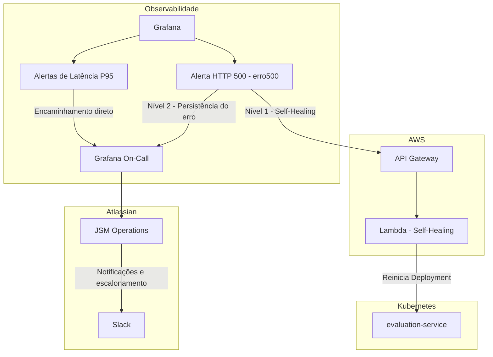

A arquitetura de alertas integra o Grafana ao Jira Service Management Operations, permitindo o gerenciamento de incidentes, classificação por prioridade e acionamento da equipe de on-call via Slack.

Para condições específicas de falha, foi implementado um mecanismo de Self-Healing utilizando AWS API Gateway e Lambda.

O fluxo permite:

- Identificação de falhas por meio das Alert Rules do Grafana.
- Encaminhamento de webhooks para o API Gateway.
- Execução da automação de recuperação pelo Lambda.
- Reinicialização do Deployment afetado no Kubernetes.
- Registro das execuções no CloudWatch Logs.


### Alertas Implementados

A estratégia de alertas do ToggleMaster foi desenvolvida para identificar degradações de desempenho e falhas nos microsserviços, permitindo uma resposta rápida a incidentes. As regras são provisionadas no Grafana, utilizando métricas coletadas pelo Prometheus, e integradas ao Jira Service Management (JSM) para gerenciamento de incidentes e notificações no Slack.

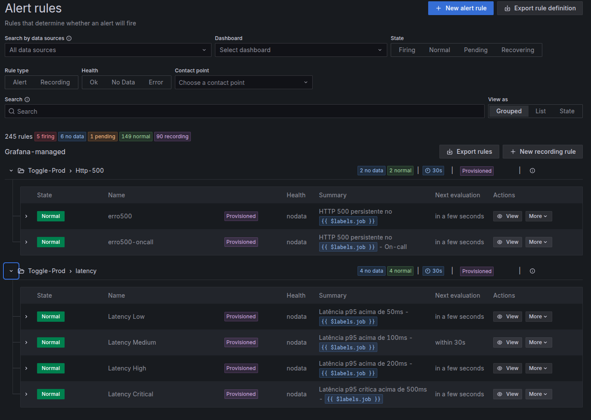

#### Alertas de Latência P95

Os alertas de latência utilizam o percentil 95 (P95) da duração das requisições HTTP, calculado a partir da métrica `http_server_duration_milliseconds_bucket`. Esse indicador representa o tempo abaixo do qual 95% das requisições são concluídas, permitindo identificar degradações de desempenho.

A classificação dos alertas considera quatro níveis de prioridade:

| Prioridade | Severidade | Descrição                                                    |
| ---------- | ---------- | ------------------------------------------------------------ |
| P1         | Critical   | Latência crítica, indicando degradação severa do desempenho e necessidade de intervenção prioritária. |
| P2         | High       | Latência elevada, indicando comprometimento significativo do tempo de resposta. |
| P3         | Medium     | Latência moderada, indicando degradação que requer acompanhamento. |
| P4         | Low        | Latência entre 50 ms e 100 ms, indicando aumento inicial do tempo de resposta. |

Essa classificação permite diferenciar os níveis de degradação, priorizando o tratamento dos incidentes de acordo com sua severidade.

#### Alerta de Erro HTTP 500 – `erro500`

O alerta `erro500` monitora a ocorrência de respostas HTTP 500 (Internal Server Error) nos microsserviços da aplicação, identificando falhas internas durante o processamento das requisições.

Quando acionado, o alerta inicia o fluxo de self-healing implementado na AWS:

1. O Grafana identifica a condição de erro e dispara o alerta.
2. A notificação é encaminhada por webhook ao API Gateway.
3. O API Gateway invoca a função AWS Lambda responsável pela recuperação.
4. A Lambda executa a reinicialização do Deployment correspondente no namespace `toggle-prod`.

Esse mecanismo automatiza a recuperação de componentes afetados, reduzindo a necessidade de intervenção manual e contribuindo para a disponibilidade da plataforma.

### Gerenciamento de Incidentes

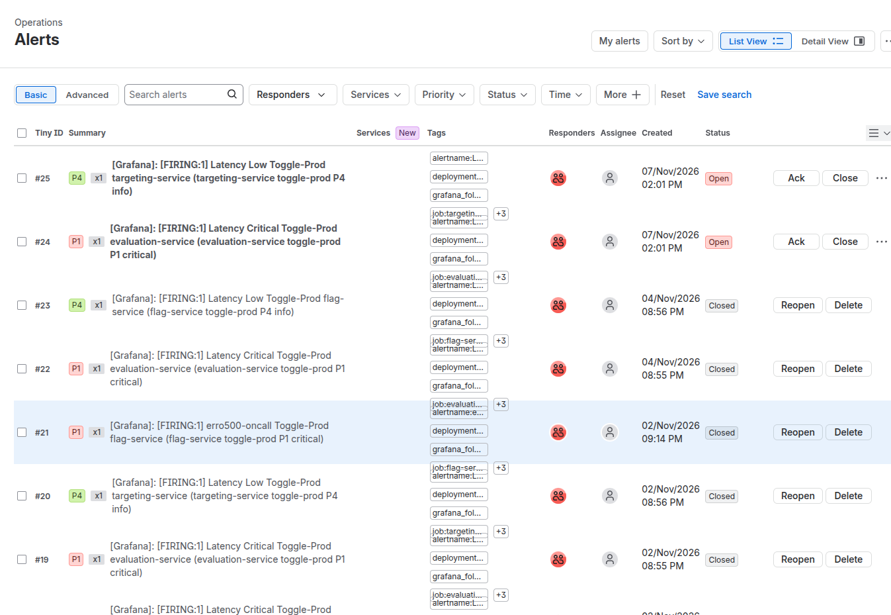

Os alertas do Grafana são integrados ao Jira Service Management Operations, permitindo o encaminhamento e acompanhamento dos incidentes conforme suas prioridades e severidades. A integração com Slack complementa o processo de comunicação, disponibilizando notificações para acompanhamento operacional.

A implementação combina monitoramento contínuo, classificação de severidade, gerenciamento de incidentes e recuperação automatizada. Os alertas P95 permitem identificar degradações progressivas de desempenho, enquanto o alerta HTTP 500 integra o mecanismo de self-healing, contribuindo para a resiliência e disponibilidade da plataforma ToggleMaster.

Na integração entre o Grafana e o Jira Service Management, foi implementado o ajuste automático de Prioridade e o fechamento automático do alerta após a normalização de forma a ajustar dinamicamente os operadores.

#### Integrações

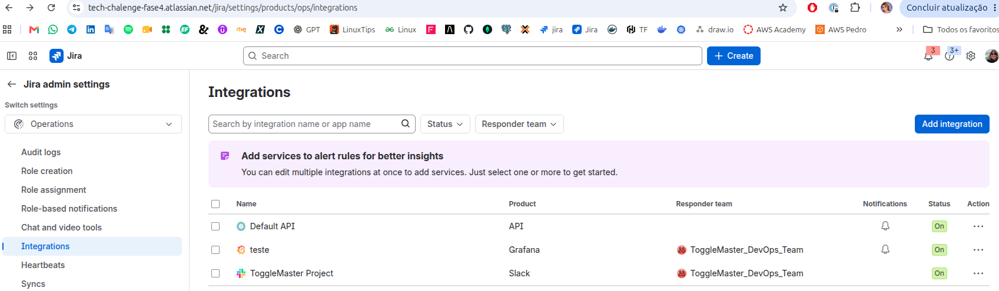

### Notificação (ChatOps)

Foi escolhido o Slack como ferramenta de On-Call.

O JSM é integrado ao Slack de forma bidirecional, de forma que os alertas são enviados para o slack, e um ack ou fechamento do alerta via slack se reflete no Jira Service Management.

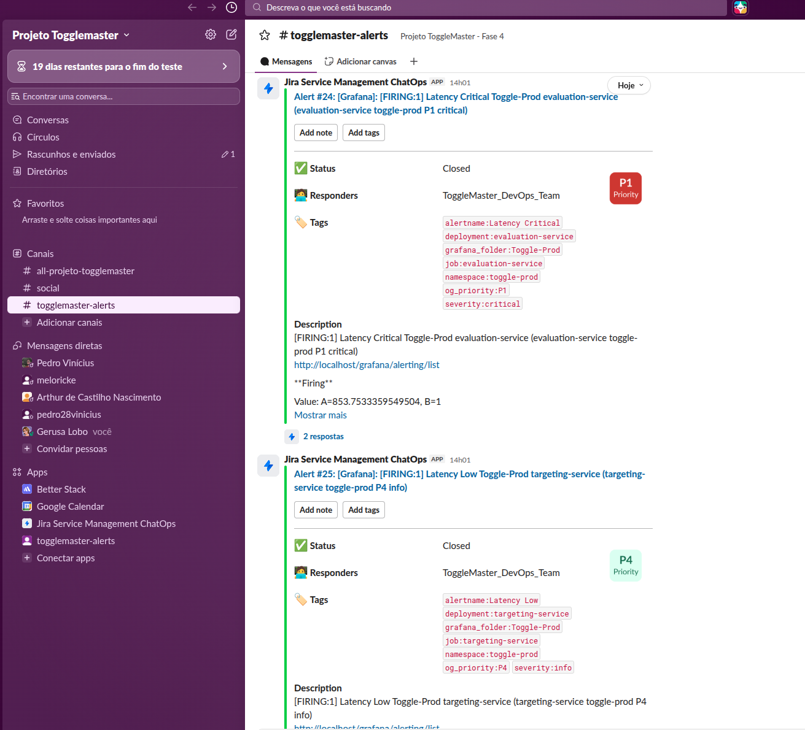

### Self-Healing

Foi implementada uma função AWS Lambda em Python (`app.handler`) para receber o webhook do Grafana e solicitar o reinício gradual de um Deployment no Amazon EKS. O caminho é: Grafana → API Gateway → Lambda → API Kubernetes do EKS.

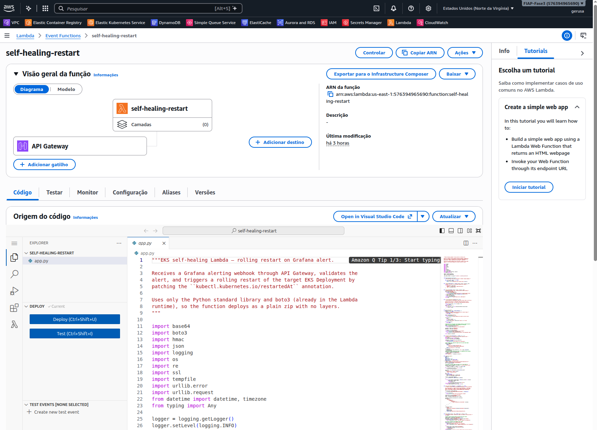

A função valida o método HTTP, compara o token Bearer em tempo constante, interpreta JSON simples ou codificado em Base64 e ignora alertas resolvidos ou sem alertas `firing`. Para um alerta em disparo, exige `namespace` e `deployment`, restringe o namespace por `ALLOWED_NAMESPACE` e valida o formato DNS do nome antes de usá-lo na URL da API.

Para autenticar no EKS, a Lambda assina uma solicitação `GetCallerIdentity` do STS com as credenciais IAM do runtime e gera um token temporário. A conexão com a API Kubernetes usa HTTPS e valida o certificado CA do cluster. O reinício é solicitado por um `PATCH` que atualiza `kubectl.kubernetes.io/restartedAt` no pod template; o Kubernetes executa o rolling update conforme a estratégia do Deployment. A resposta confirma o pedido, mas não aguarda o rollout terminar.

O acesso é limitado por duas camadas: a validação de namespace na aplicação e o RBAC do grupo `self-healing`, que concede `patch` e `get` em Deployments no namespace configurado. O token compartilhado do webhook e a role IAM da Lambda são controles distintos: o primeiro autentica o remetente; a segunda fornece identidade AWS para o acesso ao EKS. O endpoint privado do cluster exige conectividade de rede da Lambda, normalmente por VPC.

Por decisão de implementação, a função não exclui pods diretamente: altera o template e deixa a disponibilidade durante o rollout sob controle do Kubernetes. Se o Deployment retornar `404`, a operação é tratada como sem ação necessária. Erros de autorização do Kubernetes são reportados como falha de integração. Se houver vários alertas `firing` no mesmo webhook, somente o primeiro é processado.

As variáveis necessárias incluem `WEBHOOK_BEARER_TOKEN`, `ALLOWED_NAMESPACE`, `EKS_CLUSTER_NAME`, `EKS_CLUSTER_ENDPOINT` e `EKS_CLUSTER_CA_CERTIFICATE_BASE64`; `AWS_REGION` é fornecida pelo runtime Lambda. O guia do componente descreve a role IAM, o mapeamento de acesso EKS, o RBAC, o API Gateway e os requisitos de rede. O pacote da Lambda pode conter somente `app.py`, pois `boto3` e `botocore` estão disponíveis no runtime.

O passo a passo está no [README do componente](https://github.com/castilhoarth/tech-challenge-3-k8s/blob/feature/tech-challenge-4-self-healing/README.md) e no [guia de implantação](https://github.com/castilhoarth/tech-challenge-3-k8s/blob/feature/tech-challenge-4-self-healing/setup-guide.md).

## Funcionamento da Solução

A infra sobe via Terraform.

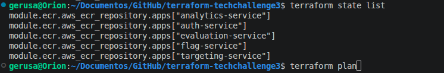

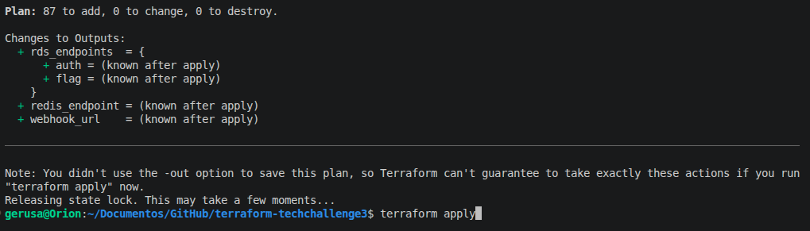

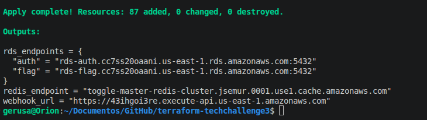

Após a infra subir, o argoCD que sobe via terraform, monitora a pasta k8s e vai subindo as aplicações, serviços e monitoramento de observabilidade.

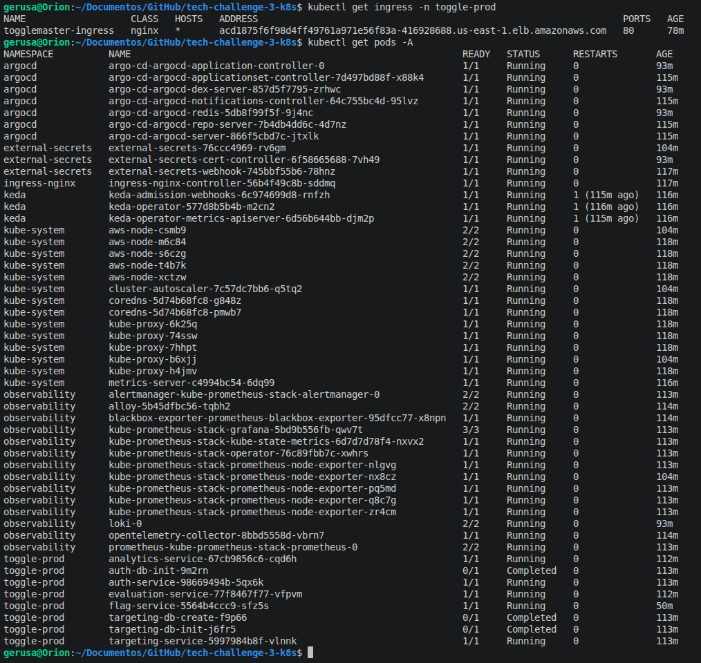

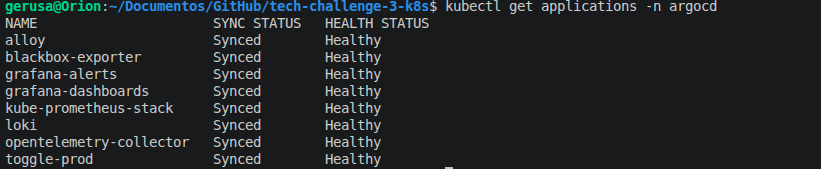

### Simulações de ativação de alertas.

Foram usados alguns testes para ativação dos alertas de latencia e do alerta de erro500.

#### Erro500 e Self Healing:

Usando um script de simulação: simulate-flag-service-errors.sh podemos simular o erro 500 numa aplicação.

Situação antes: 

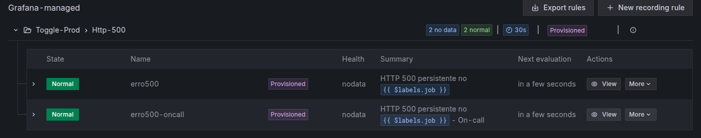

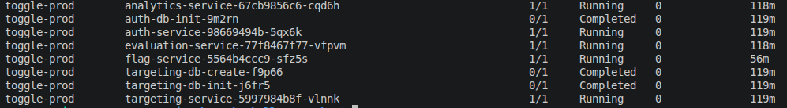

Simulação a ser executada no flag service. Iremos gerar erro500 para que o alerta identifique trigue o lambda para resetar o pod do flag-service.

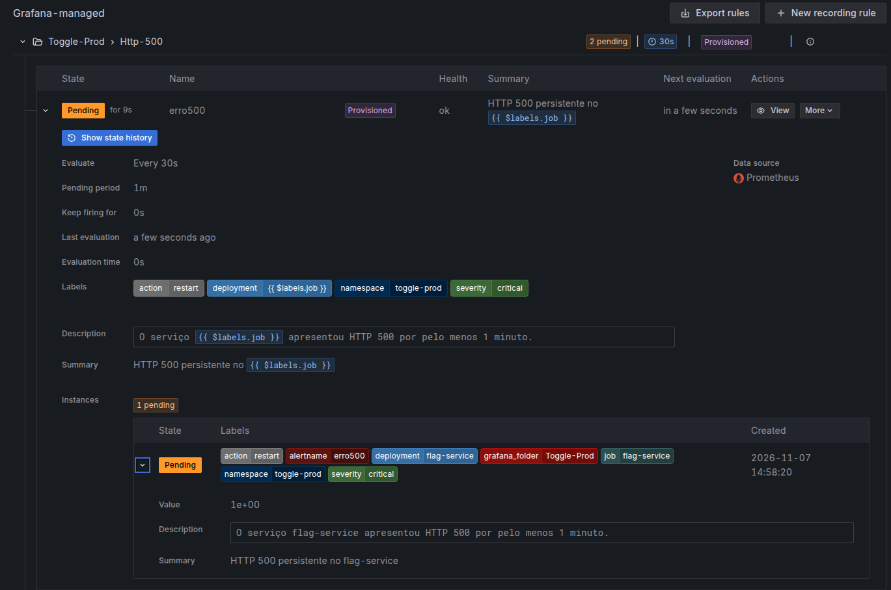

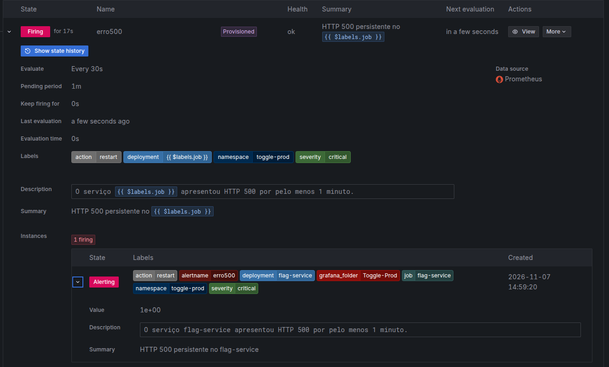

O pod reiniciado:

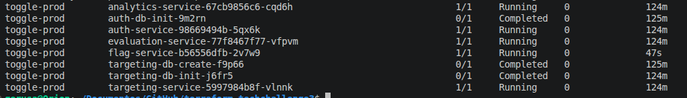

E o log no Cloud Watch:

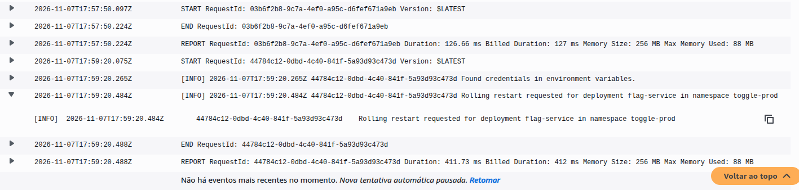

E no Dash:

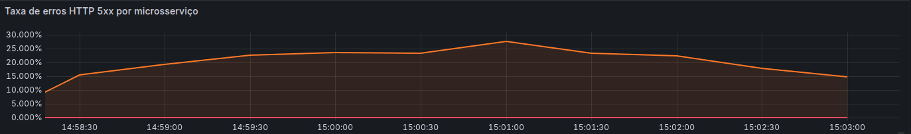

#### Erro500 e Escalação:

Caso, após o self healing, o Erro500 permaneça, e não seja resolvido, foi criada uma segunda regra que se o erro ficar ativo por mais de 3min, ele irá escalar para o Jira Service Management para que um suporte possa verificar e resolver, sendo encaminhado para o Slack em on-Call.

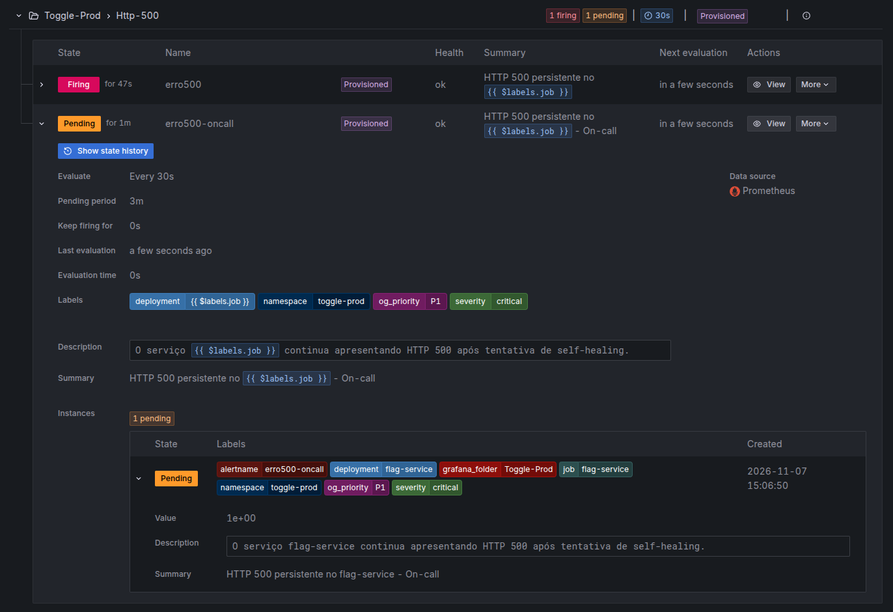

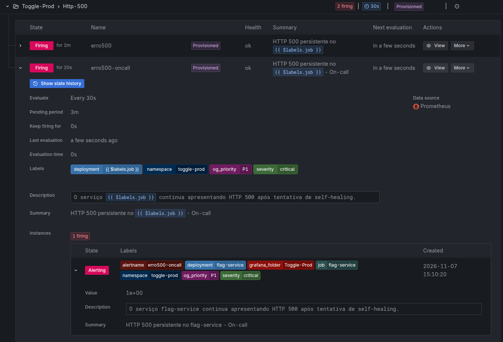

Nesse segundo disparo é enviado um alerta de criticidade P1 para o Jira Service Management que encaminha para o Slack.

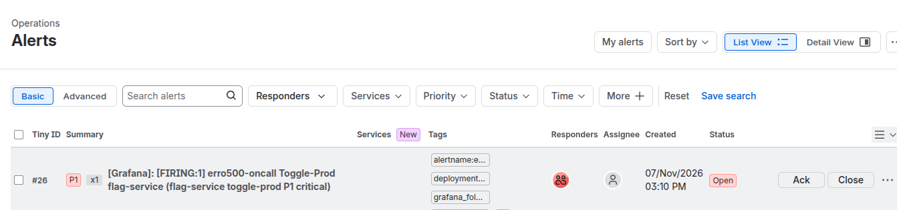

E no Slack:

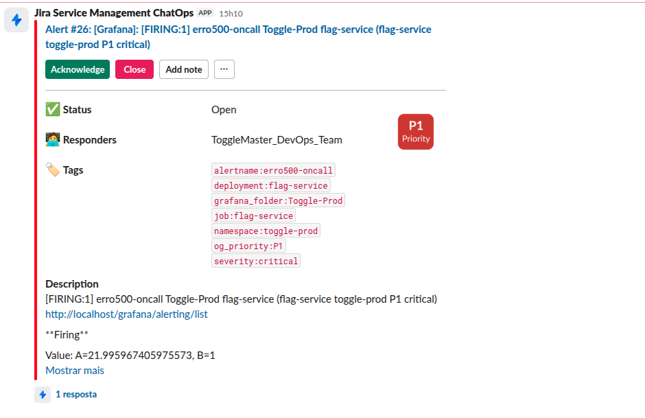

#### Simulação de Erro de Latencia:

Nessa simulção fazemos uma carga de acesso nos serviços e monitoramos a Latencia.

Antes:

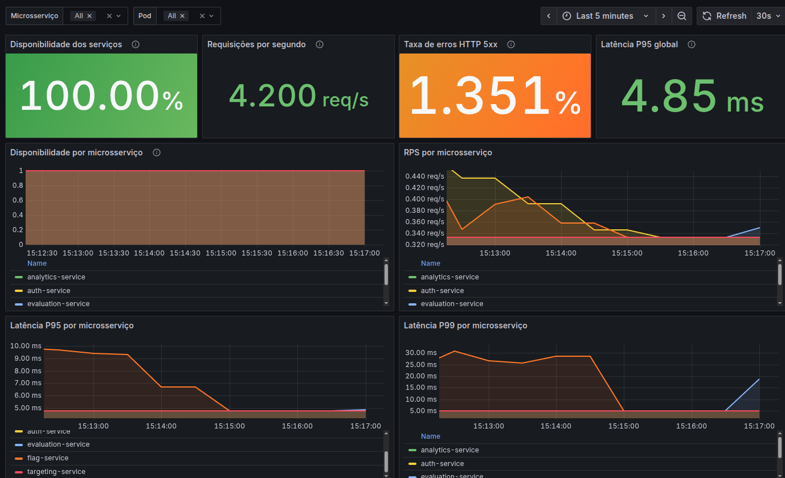

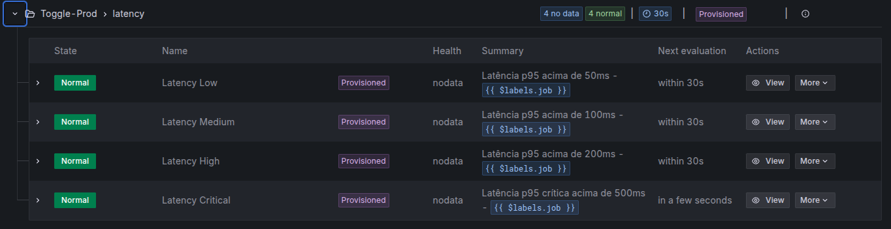

Após a simulação de carga

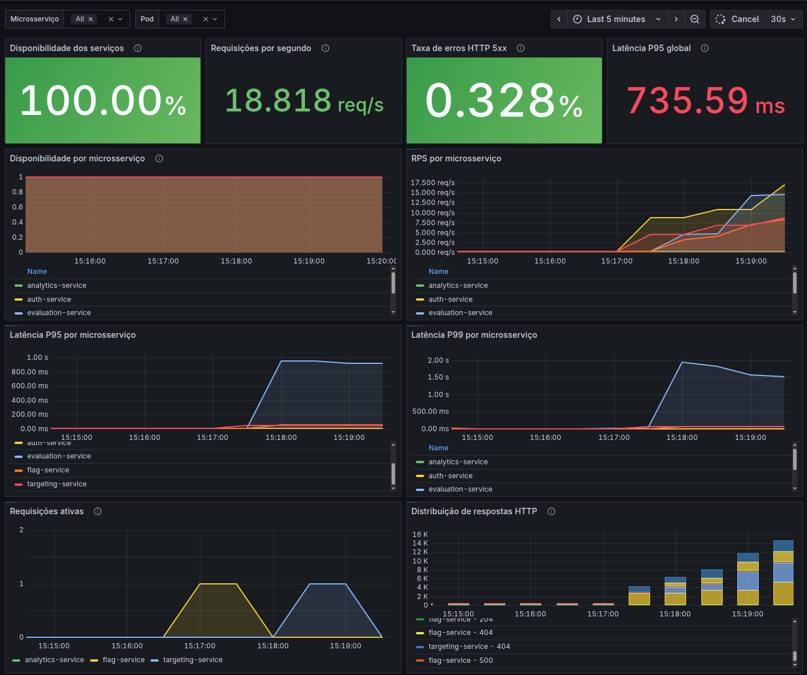

Dois serviços dispararam:

O flag service como P4, tendo chegado a 54mS de Latencia.

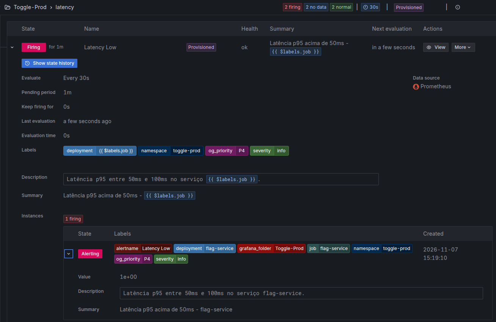

O evaluation como P1 tendo chegado a 800mS de Latência.

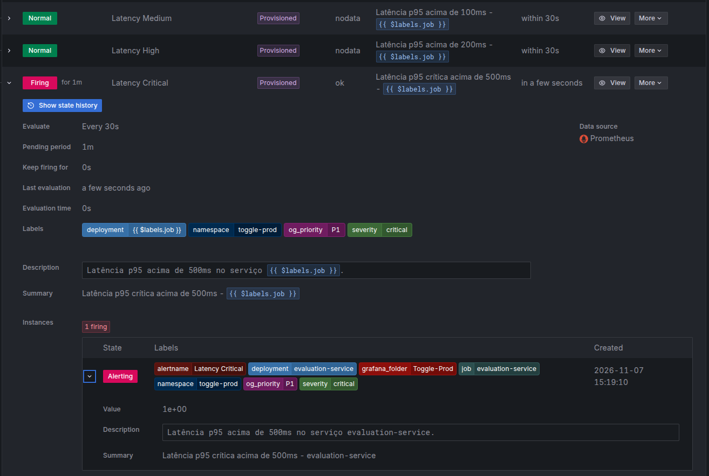

No Jira Service Management:

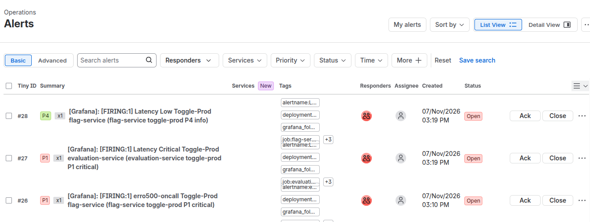

E no Slack:

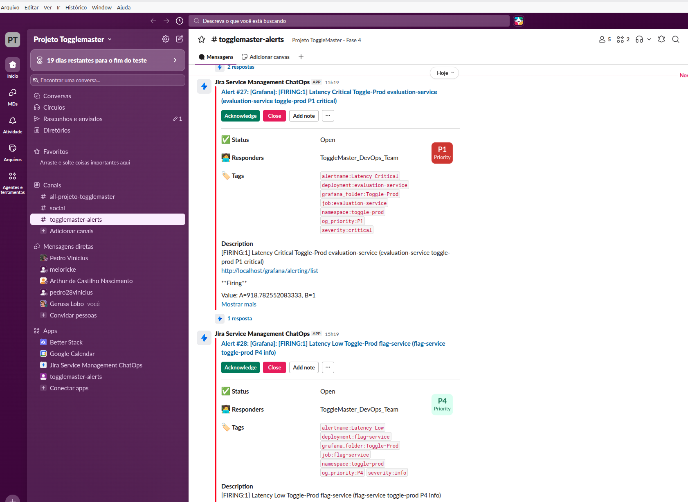

## Desafios Encontrados

Durante a implementação da solução de observabilidade, foram identificados desafios relacionados à capacidade da infraestrutura, configuração dos componentes, integração entre ferramentas e gerenciamento de credenciais.

### 1. Limitação de capacidade dos nodes Kubernetes

Inicialmente, a infraestrutura do EKS apresentava limitações na quantidade de pods que poderiam ser executados simultaneamente por node. Essa restrição impactou a implantação dos microsserviços e dos componentes de observabilidade.

Para solucionar o problema, foi necessário aumentar o tamanho dos nodes de Micro para Small e ajustar a quantidade de nodes do cluster, ampliando sua capacidade de execução. Também foi necessário ajustar o Grafana Alloy de DaemonSet para Deployment com uma réplica, reduzindo a quantidade de pods necessários para coleta de logs.

Após os ajustes, os deployments passaram a apresentar condições estáveis de execução.

### 2. Problemas de comunicação com o OpenTelemetry Collector

Durante a configuração da instrumentação, foram identificados problemas de resolução DNS entre os microsserviços e o OpenTelemetry Collector.

Inicialmente, o endpoint configurado não permitia a comunicação adequada. A solução foi utilizar o DNS completo do serviço Kubernetes:

```
opentelemetry-collector.observability.svc.cluster.local:4318
```

Também foi necessário configurar o protocolo `http/protobuf`, garantindo o envio dos dados via OTLP.

### 3. Padronização da instrumentação OpenTelemetry

A instrumentação dos microsserviços exigiu a padronização das variáveis de ambiente responsáveis pela configuração do OpenTelemetry.

Foram configurados os endpoints de exportação, protocolos, exporters e nomes dos serviços, garantindo que os microsserviços Go e Python utilizassem corretamente o OpenTelemetry Collector como destino.

Essa padronização facilitou a manutenção e a identificação dos serviços nas ferramentas de observabilidade.

### 4. Identificação incorreta dos microsserviços no New Relic

Inicialmente, alguns microsserviços Python eram identificados no New Relic como `unknown_service:python3.11`, dificultando a identificação das aplicações no APM e no Distributed Tracing.

Para solucionar o problema, foi necessário configurar explicitamente a variável `OTEL_SERVICE_NAME` em cada microsserviço.

Após os ajustes e reinicialização dos deployments, os cinco microsserviços passaram a ser identificados individualmente no New Relic.

### 5. Configuração e validação do pipeline de traces

Durante a implementação do OpenTelemetry Collector, foi necessário configurar e validar o pipeline de traces, garantindo que os dados recebidos dos microsserviços fossem encaminhados corretamente ao New Relic.

Também foram utilizados mecanismos de diagnóstico, incluindo o debug exporter, para verificar o recebimento e processamento dos traces.

Esse processo permitiu identificar problemas de configuração e validar o funcionamento da integração com o APM.

### 6. Possibilidade de duplicidade na coleta de logs

A implementação da centralização de logs exigiu atenção à possibilidade de duplicidade de registros, considerando que os logs poderiam ser coletados pelo Grafana Alloy e também enviados diretamente pelos microsserviços via OTLP ao OpenTelemetry Collector.

Foi necessário avaliar os mecanismos de coleta e encaminhamento, evitando duplicidade e garantindo a centralização dos logs no Loki.

Também foram ajustados os labels utilizados nas consultas LogQL, facilitando a identificação dos microsserviços e a investigação de erros.

### 7. Sincronização e gerenciamento GitOps pelo Argo CD

A utilização do Argo CD para gerenciamento GitOps exigiu atenção à sincronização entre os manifests versionados no Git e os recursos implantados no Kubernetes.

Durante o processo, foram identificadas divergências de estado entre recursos declarados e recursos existentes no cluster, especialmente em deployments com escalabilidade dinâmica pelo HPA.

Foi necessário analisar as diferenças de configuração e ajustar a estratégia de sincronização, preservando o comportamento dos recursos gerenciados automaticamente pelo Kubernetes.

### 8. Gerenciamento seguro de credenciais e secrets

A configuração das integrações com New Relic, AWS Lambda e Jira Service Management exigiu o gerenciamento seguro de credenciais e tokens.

Para evitar a exposição de informações sensíveis em arquivos versionados ou manifests Kubernetes, foram utilizados recursos de gerenciamento de secrets, incluindo AWS Secrets Manager e Kubernetes Secrets, conforme a necessidade de cada integração.

Esse processo permitiu separar as credenciais das configurações operacionais, proteger tokens de autenticação e facilitar a manutenção das integrações.

### 9. Exposição dos serviços de observabilidade via Ingress NGINX

A disponibilização do Grafana e Prometheus para acesso externo exigiu a configuração do Ingress NGINX, incluindo regras de roteamento e integração com os serviços internos do Kubernetes.

Foi necessário ajustar os recursos de Ingress e validar a comunicação entre o controlador e os serviços de observabilidade.

Após os ajustes, foi possível disponibilizar as interfaces de monitoramento para consulta de dashboards, métricas e logs.

### 10. Integração do Grafana com AWS Lambda para Self-Healing

A implementação do mecanismo de self-healing exigiu a integração entre os alertas do Grafana, o API Gateway e a AWS Lambda responsável por reiniciar os deployments Kubernetes.

Foi necessário configurar o fluxo de comunicação, autenticação e permissões IAM para que os alertas pudessem acionar a Lambda corretamente.

Também foi necessário configurar o gerenciamento seguro das credenciais utilizadas na integração, evitando a exposição de tokens e informações sensíveis.

Após os ajustes, o mecanismo passou a permitir o acionamento automatizado da recuperação de workloads a partir dos alertas configurados.

### 11. Integração de alertas com Jira Service Management

A integração entre Grafana e Jira Service Management exigiu a configuração de autenticação, endpoints e credenciais de acesso ao JSM.

Foi necessário utilizar secrets para armazenar de forma segura os tokens e dados de autenticação utilizados na integração, mantendo essas informações separadas dos arquivos versionados.

Essa integração possibilitou encaminhar alertas de observabilidade para o gerenciamento de incidentes, permitindo organizar prioridades, acompanhar ocorrências e realizar o escalonamento operacional.

### 12. Configuração e validação das regras de alertas

A implementação das regras de alertas exigiu a definição de limites de latência e disponibilidade, considerando diferentes níveis de severidade.

Foram configuradas regras baseadas no percentil 95 (p95) da latência dos microsserviços, permitindo identificar degradações de desempenho e encaminhar os eventos para os mecanismos de notificação e gerenciamento de incidentes.

Também foi necessário validar os alertas por meio de testes de carga e simulações de indisponibilidade, garantindo que as regras fossem acionadas conforme os critérios definidos.

## Justificativas

### Arquitetura OpenTelemetry

A arquitetura de observabilidade da ToggleMaster foi implementada utilizando o OpenTelemetry como padrão de instrumentação e integração entre os microsserviços e as ferramentas de monitoramento.

O OpenTelemetry Collector foi adotado como componente central de recebimento, processamento e encaminhamento da telemetria, permitindo desacoplar a instrumentação das aplicações dos backends de observabilidade.

Os microsserviços Go e Python foram instrumentados para exportar traces, métricas e logs via OTLP. O Collector recebe esses dados e os direciona conforme sua finalidade:

- **Traces:** encaminhados ao New Relic para análise de desempenho, rastreamento distribuído e identificação de gargalos.
- **Métricas:** integradas ao Prometheus, incluindo métricas de aplicações, infraestrutura Kubernetes e verificações de disponibilidade realizadas pelo Blackbox Exporter.
- **Logs:** encaminhados ao Loki, permitindo centralização, pesquisa e análise dos registros das aplicações.

Complementarmente, o Grafana Alloy realiza a coleta dos logs dos containers Kubernetes, encaminhando-os ao Loki. O Grafana é utilizado como camada de visualização, permitindo consolidar métricas, logs e dashboards operacionais.

Essa arquitetura oferece flexibilidade, reduz o acoplamento entre aplicações e ferramentas comerciais e permite substituir ou adicionar backends de observabilidade sem exigir alterações significativas na instrumentação dos microsserviços.

### Escolha entre Datadog e New Relic

Para a observabilidade distribuída (APM e Distributed Tracing), optou-se pela utilização do New Relic. O fator determinante para a escolha foi o modelo de custos: o New Relic oferece um plano gratuito (free tier) mais generoso (100 GB/mês de ingestão sem custo), o que viabilizou o projeto sem gerar custos de infraestrutura de monitoramento.

Ambos os fornecedores (New Relic e Datadog) oferecem recursos equivalentes e maduros de observabilidade, incluindo:

- Suporte nativo ao OpenTelemetry: Garantia de instrumentação 100% neutra (vendor-agnostic), enviando dados via OpenTelemetry Collector.
- Recursos avançados de APM: Visualização completa de traces, mapeamento de dependências entre microsserviços e análise de desempenho e latência.

Portanto, a escolha do New Relic deu-se exclusivamente pela relação custo-benefício para a escala do projeto, mantendo a arquitetura pronta para eventuais migrações no futuro graças ao OpenTelemetry.

### Escolha entre OpsGenie e PagerDuty

Para gerenciamento de incidentes e escalonamento operacional, OpsGenie e PagerDuty são soluções que oferecem recursos de alertas, gerenciamento de incidentes, escalas de plantão e notificações.

Foi verificado que o Opsgenie já está em fim de vida útil tendo sido substituido pelo Jira Service Management no ecossistema Atlassian e o PageDuty tem uma limitação de trial de apenas 15 dias. 

Dessa forma no projeto ToggleMaster, foi utilizado o Jira Service Management - módulo de Operations no modo free tier sem limitação de tempo, integrado aos alertas do Grafana, em vez de adotar OpsGenie ou PagerDuty.

Essa decisão considerou a integração com o ecossistema Atlassian, a centralização do gerenciamento de incidentes e a possibilidade de utilizar os recursos de operações e notificações associados ao Jira Service Management.

O fluxo implementado permite encaminhar alertas do Grafana ao JSM, organizar incidentes por prioridade e realizar notificações e escalonamentos operacionais, incluindo integração com Slack.

Dessa forma, foi possível demonstrar um fluxo de gerenciamento de incidentes integrado à observabilidade, sem introduzir uma plataforma adicional exclusivamente para gerenciamento de plantões.

### Considerações finais

A arquitetura adotada combina instrumentação aberta com ferramentas especializadas, permitindo manter independência tecnológica na coleta da telemetria e utilizar plataformas adequadas para análise de traces, visualização de métricas e logs e gerenciamento de incidentes.

A utilização do OpenTelemetry como padrão de instrumentação, Prometheus e Loki para armazenamento e consulta, Grafana para visualização, New Relic para APM e Jira Service Management para operações resulta em uma solução modular, integrada e extensível.

## Video de Apresentação
